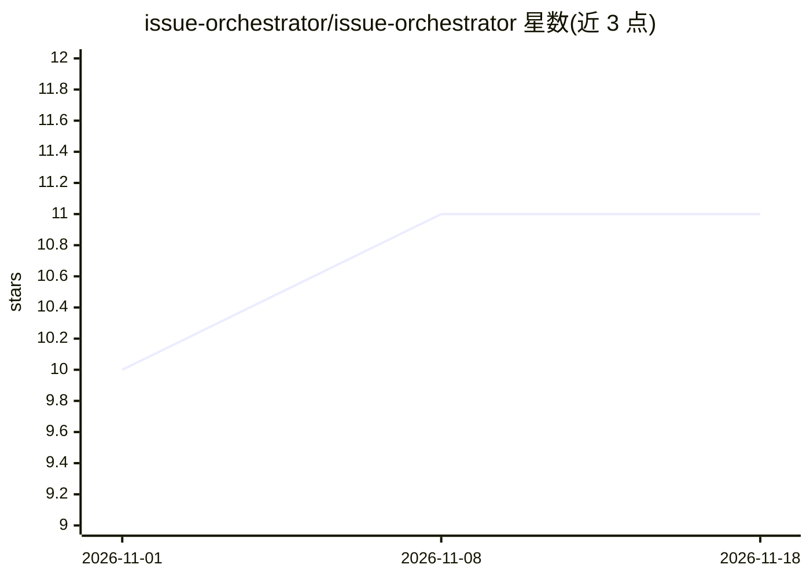

# issue-orchestrator/issue-orchestrator

⭐ 11 · Python · Apache-2.0 · 推送 2026-11-17 · [GitHub](https://github.com/issue-orchestrator/issue-orchestrator) · 组织维护

**给开发团队编排 AI agent 按 GitHub issue 受控干活**

一个面向编码 agent 的控制平面：将 GitHub issue 转化为隔离 git worktree 中的有界执行 run，通过验证、审查、返工、人工合并等门禁决定代码推进、打回或需人工处理。以 GitHub 标签和 worktree 状态为崩溃恢复的外部事实源，提供仪表盘、会话回放、MCP server 与 VS Code 集成。核心原则是 agent 只产出变更，编排器拥有状态裁决权，人类掌握合并权限。当前为 0.x 阶段，公开 API 明确不稳定。

## 筛选速览

| 维度 | 判定 | 备注 |
|---|---|---|
| AI 角色 | `ai-ecosystem` | LLM/agent 周边工具 |
| 许可风险 | `permissive` | Apache-2.0 |
| 部署形态 | `None` |  |
| 模型依赖 | — | README 未给出锁定关系 |
| 硬件要求 | — | 无带数字的原话,不猜 |
| 安装摩擦 | `low` | 无编译、无系统依赖或容器化 |
| 成熟度 | `idea` | |

## 能力要点

- 每个 issue 创建隔离 git worktree 支持并发 agent 工作
- 验证、审查、有界返工、发布门禁的状态机工作流
- 会话录制与回放用于调试和审计 agent 行为
- 通过 MCP server 支持浏览器、VS Code 与 AI 客户端接入

## 适用场景

- 小团队在真实仓库上规模化使用编码 agent
- 要求人工合并、强制验证门禁的 agent 工作流
- 审计 agent 完成声明并回放其编码会话

## 场景标签

`编码 Agent` `代码审查` · 领域:编码与开发

## 证据(README 行号)

> L3: Issue-Orchestrator is a control plane for coding agents built around software engineering discipline. It turns GitHu
> L17: - Runs coding, review, rework, and tech lead sessions through configured agent providers.

## 星数曲线

2026-11-01 10 → 2026-11-18 11（+1）

---
*卡片 v1 · prompt 1.4 · 生成 2026-11-18 · 置信度 high · 依据 README sha `9f6bb82ced7f` · [字段定义](../../DATASET.md)*
