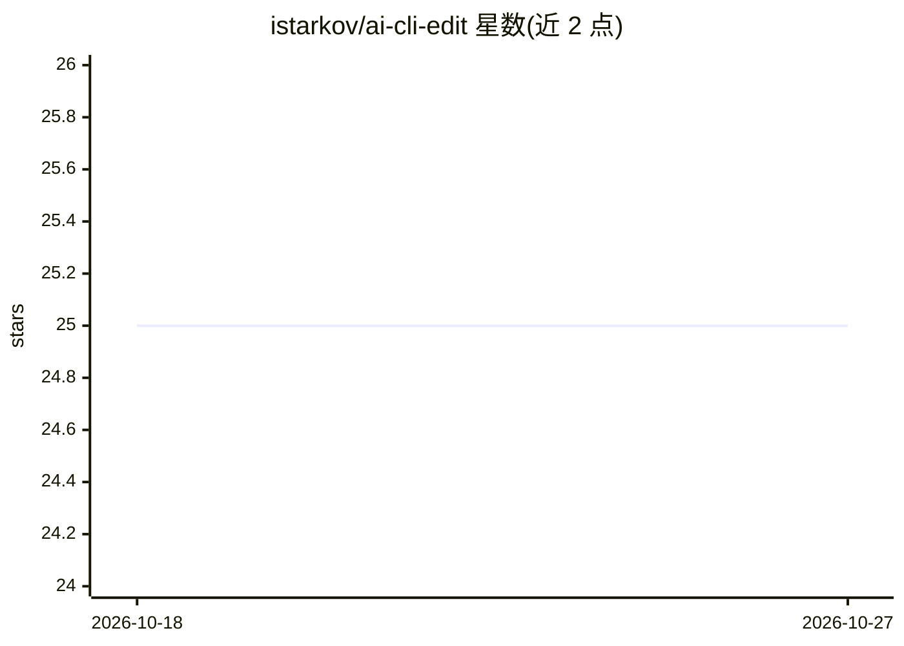

# istarkov/ai-cli-edit

⭐ 25 · HTML · 推送 2025-11-23 · [GitHub](https://github.com/istarkov/ai-cli-edit) · [官网](https://istarkov.github.io/ai-cli-edit/) · 个人维护

**浏览器元素选择工具：为 AI 编码工具生成结构化编辑提示**

基于 Bun 运行的浏览器端页面选择工具：在 DOM 中选取元素后，将用户编辑意图与选择上下文组合成 <edit> 格式的剪贴板内容，粘贴到 OpenCode、Claude Code、VSCode Copilot、Cursor 等 AI 编码工具中执行修改。README 同时讲解通过 OpenCode Primary Agents（.opencode/agent/edit.md）或 Claude Skills 隔离任务指令、设定模型参数与工具的做法。运行需克隆仓库并用 bun run --hot 启动开发服务器，另有 GitHub Pages 上的在线演示。

## 筛选速览

| 维度 | 判定 | 备注 |
|---|---|---|
| AI 角色 | `ai-ecosystem` | LLM/agent 周边工具 |
| 许可风险 | `none` | — |
| 部署形态 | `None` |  |
| 模型依赖 | — | README 未给出锁定关系 |
| 硬件要求 | — | 无带数字的原话,不猜 |
| 安装摩擦 | `low` | 无编译、无系统依赖或容器化 |
| 成熟度 | — | 结构信号不足 |

## 能力要点

- DOM 元素选择与 Alt 上下键层级导航，生成结构化 edit 提示并复制到剪贴板
- 与 OpenCode、Claude Code、VSCode Copilot、Cursor 等 AI 编码工具配合使用
- 提供 OpenCode Primary Agents 专用 agent 定义文件的配置说明
- GitHub Pages 提供在线演示

## 适用场景

- 在浏览器里选中页面元素后，把编辑需求生成为提示交给 AI 编码工具
- 为 AI 编辑任务隔离系统指令、模型参数与工具配置，避免污染全局配置

## 场景标签

`提示工程` · 领域:Agent 开发

## 证据(README 行号)

> L7: To run this on your machine, you will need Bun and any AI coding tool (OpenCode, Claude Code, VSCode Copilot, Cursor
> L23: Once copied, simply paste the result into your AI tool to apply the changes.

## 星数曲线

2026-10-18 25 → 2026-10-27 25（+0）

---
*卡片 v1 · prompt 1.4 · 生成 2026-10-27 · 置信度 high · 依据 README sha `ef2bc87a9c01` · [字段定义](../../DATASET.md)*
