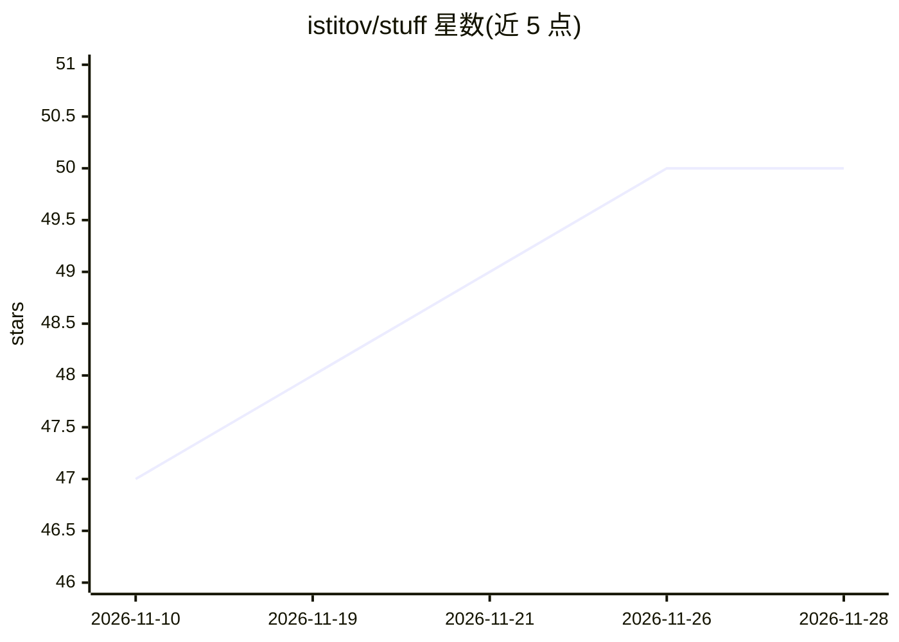

# istitov/stuff

⭐ 50 · Shell · GPL-2.0 · 推送 2026-11-27 · [GitHub](https://github.com/istitov/stuff) · [官网](https://istitov.github.io/stuff/) · 个人维护

**Gentoo ebuild 多领域软件仓库：AI/GPU 计算与材料科学打包**

一个 Gentoo Portage ebuild overlay，将难以打包的软件作为一等 Portage 公民提供：通过 emerge 安装、依赖可解析、尽量从源码构建或采用上游二进制发行版。覆盖多个领域：AMD Ryzen-AI/NPU 栈、本地 LLM 工具（llama.cpp、Ollama、llama-swap 等的 ebuild）、语音音频 ML、PyTorch/ONNX 拆分栈、ROCm 与 CUDA 补充包、生成式 AI 应用、材料科学（电子显微、SAXS/SANS、微磁学、Rietveld）、TeX Live 2025、Qt5 保留镜像与 Python 2 遗留层。主要面向 ~amd64 架构的 Gentoo 用户，需接受 testing keywords。

## 筛选速览

| 维度 | 判定 | 备注 |
|---|---|---|
| AI 角色 | `ai-ecosystem` | LLM/agent 周边工具 |
| 许可风险 | `viral` | GPL-2.0 |
| 部署形态 | `None` |  |
| 模型依赖 | — | README 未给出锁定关系 |
| 硬件要求 | — | 无带数字的原话,不猜 |
| 安装摩擦 | `medium` | 含编译或系统依赖之一 |
| 成熟度 | — | 结构信号不足 |

## 能力要点

- AMD Ryzen-AI/NPU 驱动与 LLM 运行时（FastFlowLM、Lemonade、GAIA 等）的 ebuild
- 本地 LLM 工具链打包：llama.cpp、Ollama、llama-swap、hollama、aichat、评测 harness
- 拆分式 PyTorch 栈：caffe2 拥有 libtorch，pytorch 只装 Python 包不重复编译
- 材料科学栈：HyperSpy 全家、Mantid、微磁学模拟、Rietveld 精修

## 适用场景

- 在 Gentoo 上用 emerge 统一管理本地 LLM 与 GPU 计算软件，替代手动 git 构建
- 为 AMD Ryzen AI NPU 硬件安装 NPU 优先的 LLM 运行时与驱动
- 在 Gentoo 上安装中子/X 射线散射、电子显微等科研软件包
- 在官方仓库移除后继续使用 Qt5 与 TeX Live 2025

## 场景标签

 · 领域:系统打包/科学软件仓库

## 证据(README 行号)

> L3: A Gentoo ebuild overlay that
> L13: - **Local AI & GPU compute** — AMD Ryzen-AI / NPU, AMD ROCm, NVIDIA CUDA,
> L73: Pairs with `fastflowlm` / `lemonade` above as well as `vllm` and any

## 星数曲线

2026-11-10 47 → 2026-11-28 50（+3）

---
*卡片 v1 · prompt 1.4 · 生成 2026-11-18 · 置信度 high · 依据 README sha `b5a7966c9161` · [字段定义](../../DATASET.md)*
