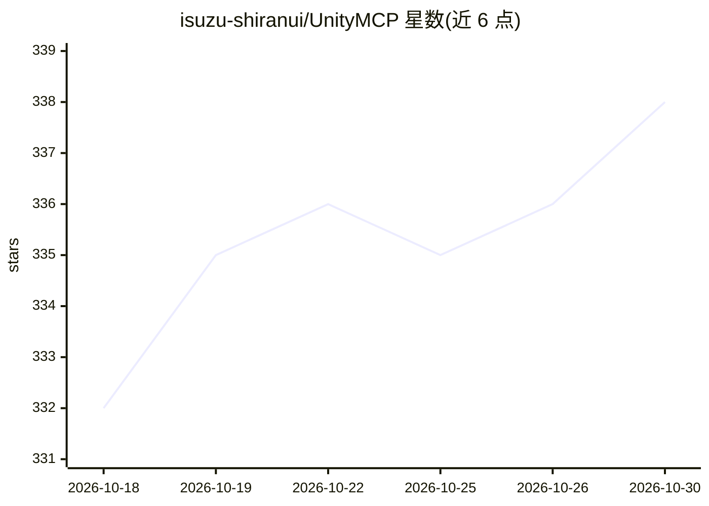

# isuzu-shiranui/UnityMCP

⭐ 338 · C# · MIT · 推送 2026-10-08 · [GitHub](https://github.com/isuzu-shiranui/UnityMCP) · [官网](https://unity-mcp.shiranui-isuzu.dev/en/) · 个人维护

**让 AI agent 与命令行直接操控 Unity Editor 的 MCP 框架**

Unity Editor 插件与配套 CLI：Editor 自身在 127.0.0.1 上以 Streamable HTTP 提供 MCP 端点，无需第二进程，Claude Code、Cursor、Codex、Gemini CLI、VS Code、Claude Desktop 等客户端可直接连接；原生可执行文件 isuzu-unity-cli 不依赖 Node 或 .NET 运行时。工具覆盖诊断（控制台/编译/测试/场景层次）、GameObject/组件/Prefab/Animator 等的创建修改、构建、C# 代码片段执行与输入合成；在 C# 静态方法上加 [McpTool] 属性或写 JSON 文件即可扩展工具。需要 Unity 2022.3+，经 Package Manager git URL 或 VPM 仓库安装。

## 筛选速览

| 维度 | 判定 | 备注 |
|---|---|---|
| AI 角色 | `ai-ecosystem` | LLM/agent 周边工具 |
| 许可风险 | `permissive` | MIT |
| 部署形态 | `None` |  |
| 模型依赖 | — | README 未给出锁定关系 |
| 硬件要求 | — | 无带数字的原话,不猜 |
| 安装摩擦 | `medium` | 含编译或系统依赖之一 |
| 成熟度 | — | 结构信号不足 |

## 能力要点

- Editor 自身经 HTTP 直接提供 MCP 端点，无第二进程
- isuzu-unity-cli 为原生可执行文件，不需要 Node/.NET 运行时
- 工具覆盖诊断、场景/资产编写、构建、C# 代码段执行、输入合成
- [McpTool] 属性标注 C# 方法或 JSON 文件即可扩展自定义工具

## 适用场景

- 让 Claude Code/Cursor 等 agent 直接在 Unity Editor 中做场景与资产操作
- 用 CLI 在终端执行 Unity 的再编译验证、错误收集与测试
- 为 Unity 工作流编写自定义 MCP 工具供 agent 调用

## 场景标签

`Agent 框架` · 领域:Agent 开发

## 证据(README 行号)

> L10: Unity Editor を AI エージェントに開放するフレームワークです。人が手で実行しても、スクリプトから呼んでも、同じ経路を通ります。
> L12: - MCP クライアントは、Editor 自身が公開する Streamable HTTP エンドポイント `http://127.0.0.1:<port>/mcp` に直接接続します。別プロセスの MCP サーバーはありません。C

## 星数曲线

2026-10-18 332 → 2026-10-30 338（+6）

---
*卡片 v1 · prompt 1.4 · 生成 2026-10-21 · 置信度 high · 依据 README sha `0b6f5eae9c24` · [字段定义](../../DATASET.md)*
