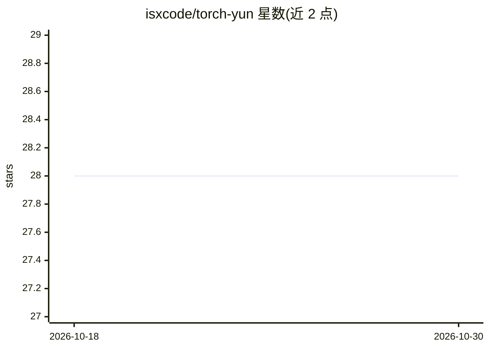

# isxcode/torch-yun

⭐ 28 · Java · Apache-2.0 · 推送 2026-06-23 · [GitHub](https://github.com/isxcode/torch-yun) · [官网](https://zhishuyun.isxcode.com) · 组织维护 · 中文 README

**面向企业的轻量级 AI 应用平台：AI 对话、模型部署与训练**

至数云（torch-yun）是一款企业级人工智能应用平台，提供 AI 对话、计算集群与资源管理、模型广场、模型仓库、智能体与应用管理、多租户后台等功能，支持大模型部署、模型训练、模型编排与接口开放，兼容通义千问和 DeepSeek 模型。以 Docker 单容器一键部署，也可从源码构建安装包。功能列表标注包含商业版功能，并提供在线演示环境。

## 筛选速览

| 维度 | 判定 | 备注 |
|---|---|---|
| AI 角色 | `ai-ecosystem` | LLM/agent 周边工具 |
| 许可风险 | `permissive` | Apache-2.0 |
| 部署形态 | `self-host` | docker 或自建部署 |
| 模型依赖 | — | README 未给出锁定关系 |
| 硬件要求 | — | 无带数字的原话,不猜 |
| 安装摩擦 | `low` | 无编译、无系统依赖或容器化 |
| 成熟度 | — | 结构信号不足 |

## 能力要点

- AI 对话、模型广场、模型仓库、智能体等模块化功能
- 兼容通义千问和 DeepSeek 模型
- Docker 一键部署，开箱即用
- 支持计算集群与资源管理、多租户后台

## 适用场景

- 企业内部搭建 AI 对话与模型部署平台
- 管理计算集群与模型仓库
- 通过可视化流程构建 AI 应用

## 场景标签

`聊天机器人` `模型训练` `推理引擎` · 领域:对话与助手

## 证据(README 行号)

> L30: &nbsp;&nbsp;&nbsp;&nbsp;&nbsp;&nbsp;&nbsp;&nbsp;至数云是一款超轻量、企业级人工智能应用平台。一键部署，开箱即用。可快速实现AI应用构建、大模型部署、模型训练、接口开放、可视化流程等场
> L38: |AI中心|模型广场、模型仓库、智能体、应用管理|

## 星数曲线

2026-10-18 28 → 2026-10-30 28（+0）

---
*卡片 v1 · prompt 1.4 · 生成 2026-10-26 · 置信度 high · 依据 README sha `be0e07bea497` · [字段定义](../../DATASET.md)*
