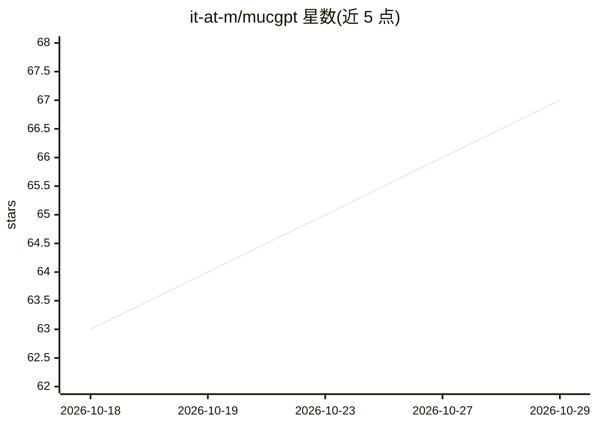

# it-at-m/mucgpt

⭐ 67 · TypeScript · MIT · 推送 2026-10-28 · [GitHub](https://github.com/it-at-m/mucgpt) · [官网](https://ki.muenchen.de/ki-systeme/mucgpt) · 组织维护

**面向公共管理部门的 LLM 网页助手系统，可创建共享个人助手**

面向公共管理部门的 AI 助手工具集：用户通过网页界面与 LLM 交互，交互由可调用多种工具的 agent 系统完成。用户可创建个人助手（工具与系统提示词的配置）并在组织内共享。采用微服务架构：React 前端（AG-UI 事件流）、FastAPI 编写的 Core Service（用 LangGraph 编排 LLM 与工具）、Assistant Service 管理助手配置、PostgreSQL 持久化、Java 版 Spring Cloud Gateway 做 API 网关，Keycloak 提供 OIDC 认证与角色权限管理；文档解析目前仅支持 Xberg 后端，可选集成 Langfuse 做追踪与提示管理。

## 筛选速览

| 维度 | 判定 | 备注 |
|---|---|---|
| AI 角色 | `ai-native` | 本体是模型或模型工具 |
| 许可风险 | `permissive` | MIT |
| 部署形态 | `None` |  |
| 模型依赖 | — | README 未给出锁定关系 |
| 硬件要求 | — | 无带数字的原话,不猜 |
| 安装摩擦 | `low` | 无编译、无系统依赖或容器化 |
| 成熟度 | — | 结构信号不足 |

## 能力要点

- 网页界面与 LLM 交互，agent 可调用多种工具
- 用户可创建并组织内共享个人助手（工具+系统提示词配置）
- Keycloak/OIDC 角色权限管理，适配行政管理场景
- 微服务架构：React 前端 + FastAPI Core/Assistant Service + PostgreSQL

## 适用场景

- 在公共管理机构内部署统一的 LLM 对话助手
- 为不同部门创建配置化的个人助手并共享
- 在 SSO 与权限管控下让员工使用 LLM 工具

## 场景标签

`AI 助手` `聊天机器人` · 领域:对话与助手

## 证据(README 行号)

> L33: MUCGPT is a system that enables users to interact with a large language model (LLM) through a web interface. This i
> L37: Users can create their own assistants and share them within the organization. A personal assistant is a configurati

## 星数曲线

2026-10-18 63 → 2026-10-29 67（+4）

---
*卡片 v1 · prompt 1.4 · 生成 2026-10-24 · 置信度 mid · 依据 README sha `e7b75fe0e223` · [字段定义](../../DATASET.md)*
