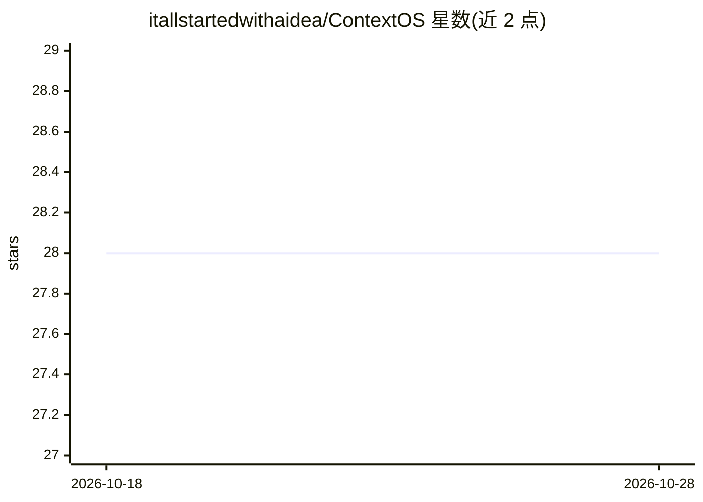

# itallstartedwithaidea/ContextOS

⭐ 28 · Python · NOASSERTION · 推送 2026-10-28 · [GitHub](https://github.com/itallstartedwithaidea/ContextOS) · [官网](https://github.com/itallstartedwithaidea/ContextOS) · 个人维护 · 中文 README

**面向 AI agent 的统一 MCP 上下文管理与编排平台**

以单个 pip 安装的 MCP 服务器 + CLI 形式提供 AI agent 的上下文工程层：整合七个开源项目（MCP servers、ragflow、Prompt-Engineering-Guide、context7、claude-mem、composio、get-shit-done、context-hub）的能力，并在 v0.2.0 加入认知层（主动遗忘、推理深度校准等六原语）、按数据变动率分级的检索路由（live/warm/cold）、自愈索引生命周期管理器（事件驱动重建、漂移检测、熔断）、分层记忆与混合检索。面向构建 agent 的开发者，需 Python 3.10+。

## 筛选速览

| 维度 | 判定 | 备注 |
|---|---|---|
| AI 角色 | `ai-ecosystem` | LLM/agent 周边工具 |
| 许可风险 | `permissive` | NOASSERTION |
| 部署形态 | `library` | 以包/库形式分发 |
| 模型依赖 | — | README 未给出锁定关系 |
| 硬件要求 | — | 无带数字的原话,不猜 |
| 安装摩擦 | `low` | 无编译、无系统依赖或容器化 |
| 成熟度 | — | 结构信号不足 |

## 能力要点

- 六认知原语：主动遗忘、综合检测、矛盾保留等检索后推理操作
- 按数据变动率（live/warm/cold）选择检索策略并自动回退
- 事件驱动重索引、嵌入模型漂移检测与熔断器
- 跨会话记忆分层（Hot/Warm/Cold）与实体图、混合检索

## 适用场景

- 为 AI agent 提供统一的 MCP 上下文服务端与 CLI
- 管理跨会话记忆与多语料检索路由
- 维护数据源索引的新鲜度与自动重建

## 场景标签

`Agent 记忆` · 领域:Agent 开发

## 证据(README 行号)

> L20: ContextOS is the **operating system layer for AI context** -- a single, unified MCP server and CLI that absorbs, ex
> L90: The foundational standard for tool execution and context protocol. ContextOS adopts MCP as its native schema and is

## 星数曲线

2026-10-18 28 → 2026-10-28 28（+0）

---
*卡片 v1 · prompt 1.4 · 生成 2026-10-26 · 置信度 high · 依据 README sha `c9c5704832a6` · [字段定义](../../DATASET.md)*
