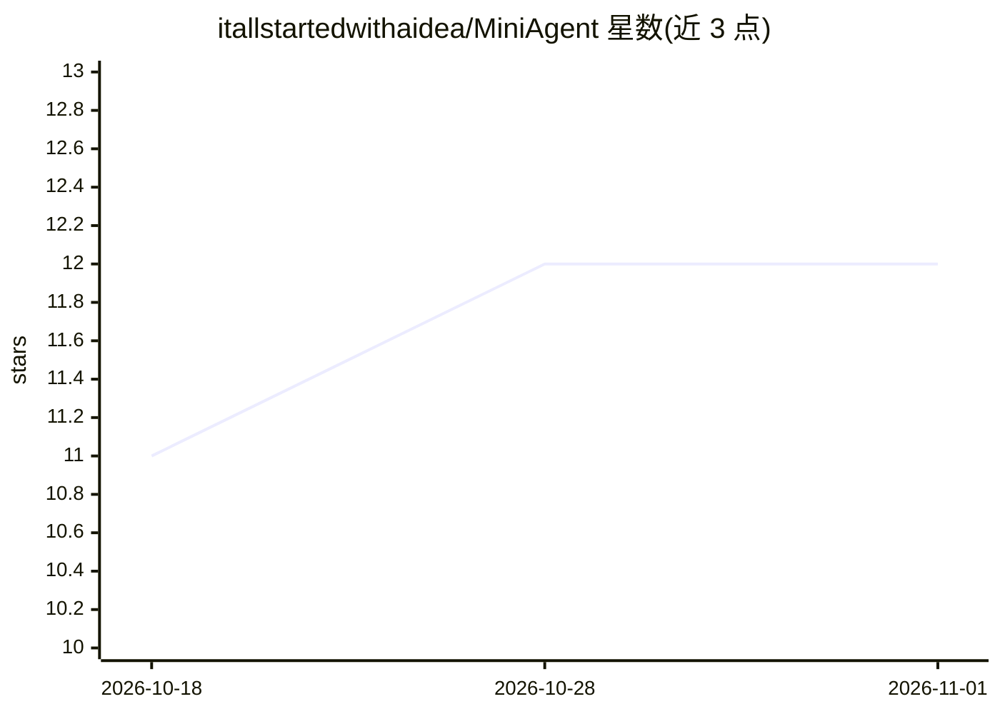

# itallstartedwithaidea/MiniAgent

⭐ 12 · Python · NOASSERTION · 推送 2026-07-20 · [GitHub](https://github.com/itallstartedwithaidea/MiniAgent) · [官网](https://googleadsagent.ai) · 个人维护

**广告领域可训练 LLM + 14 广告平台 MCP 服务器 + agent 技能**

三合一仓库：①基于 minimind 的可从零训练的广告领域 LLM（26M-494M 参数，官方给出 2 小时单卡约 $0.40 的训练流程，含预训练/SFT/DPO/蒸馏数据集）；②14 个广告平台（Google、Meta、TikTok 等）的 MCP 服务器共 80+ 工具，pip 可装，接入 Claude Code、Cursor、LangChain 等；③适配 Claude Code/Codex/Gemini CLI 的 SKILL.md 技能。作者为 15 年企业付费投放从业者。README 自述 104M 模型为 v0.1 概念验证，输出连贯性受模型规模与数据量限制。

## 筛选速览

| 维度 | 判定 | 备注 |
|---|---|---|
| AI 角色 | `ai-native` | 本体是模型或模型工具 |
| 许可风险 | `permissive` | NOASSERTION |
| 部署形态 | `library` | 以包/库形式分发 |
| 模型依赖 | local-ok | 支持本地模型 |
| 硬件要求 | — | 无带数字的原话,不猜 |
| 安装摩擦 | `low` | 无编译、无系统依赖或容器化 |
| 成熟度 | `idea` | |

## 能力要点

- minimind 基座广告域重训，单卡 2 小时/约 $0.40 可从零训练
- 14 广告平台 MCP 服务器（80+ 工具），pip extras 安装
- Claude Code/Codex/Gemini CLI 兼容的 agent 技能（SKILL.md 标准）
- 含 Ad-Bench/GAQL-Eval 等 5 个广告领域评测基准

## 适用场景

- 我想要一个能自己训练的广告投放领域小模型
- 让 Claude Code/Cursor 通过 MCP 读写我的 Google Ads/Meta 账户
- 获取 PPC 审计、GAQL 生成、预算计算等广告 agent 技能

## 场景标签

`Agent 框架` `模型训练` `微调` · 领域:Agent 开发

## 证据(README 行号)

> L24: 1. **A trainable advertising AI** — Fork of minimind (Apache 2.0, 42k stars) retrained on advertising domain data. 
> L26: 2. **A production MCP server ecosystem** — 14 ad platform connectors (Google, Meta, Microsoft, Amazon, Reddit, Trad
> L28: 3. **An agent skills platform** — Claude Code skills, Codex skills, Gemini CLI skills for advertising analysis, aud

## 星数曲线

2026-10-18 11 → 2026-11-01 12（+1）

---
*卡片 v1 · prompt 1.4 · 生成 2026-11-01 · 置信度 high · 依据 README sha `203fb29623e5` · [字段定义](../../DATASET.md)*
