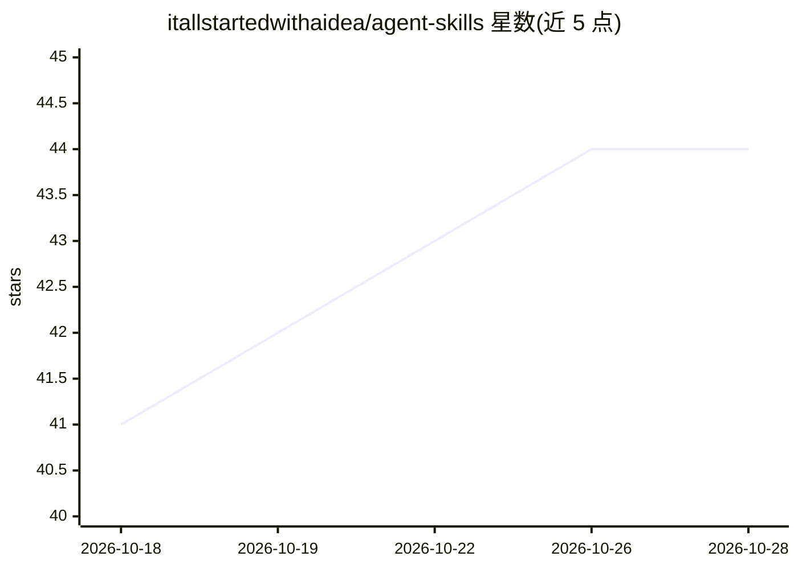

# itallstartedwithaidea/agent-skills

⭐ 44 · Shell · MIT · 推送 2026-04-12 · [GitHub](https://github.com/itallstartedwithaidea/agent-skills) · [官网](https://googleadsagent.ai) · 组织维护 · 中文 README

**面向 Google Ads 管理的 AI agent 技能库（73 个 SKILL.md）**

提供 73 个遵循 Agent Skills 规范的 SKILL.md 格式技能文件，按 Google Ads、AI Agent 工程、软件开发、科研等 10 类组织，内容来自真实广告账户运营经验。技能可被 Claude Code、Cursor、Codex、Gemini CLI 等 AI 编码代理加载使用；技能同时驱动其站内 Buddy Agent（多模型路由、1000 模式知识库）。安装方式包括 Claude Code 插件市场、npx skills 命令、git clone 源码，附校验与统计脚本。

## 筛选速览

| 维度 | 判定 | 备注 |
|---|---|---|
| AI 角色 | `ai-knowledge` | 知识聚合/清单类 |
| 许可风险 | `permissive` | MIT |
| 部署形态 | `library` | 以包/库形式分发 |
| 模型依赖 | — | README 未给出锁定关系 |
| 硬件要求 | — | 无带数字的原话,不猜 |
| 安装摩擦 | `low` | 无编译、无系统依赖或容器化 |
| 成熟度 | — | 结构信号不足 |

## 能力要点

- 73 个 SKILL.md 技能，按 10 个类别组织，含 YAML frontmatter 标准格式
- 兼容 12+ AI 编码代理（Claude Code、Cursor、Codex、Gemini CLI 等）
- 提供 Claude Code 插件市场安装与 npx skills 命令行安装
- 附 validate-skills.sh / count-skills.sh 校验统计脚本

## 适用场景

- 给 Claude Code / Cursor 等代理装载 Google Ads 审计、关键词、出价技能
- 为 AI agent 工程工作（多模型路由、实体记忆）获取现成技能模板
- 参考 SKILL.md 标准格式编写自己的 agent 技能

## 场景标签

`提示工程` · 领域:Agent 开发

## 证据(README 行号)

> L1: Agent Skills — 73 production-ready skills for AI-powered Google Ads management
> L16: Every skill is a `SKILL.md` file with YAML frontmatter per the Agent Skills spec. Here is a real skill from this re
> L95: 73 skills across 10 categories:

## 星数曲线

2026-10-18 41 → 2026-10-28 44（+3）

---
*卡片 v1 · prompt 1.4 · 生成 2026-10-25 · 置信度 high · 依据 README sha `990a47df3a06` · [字段定义](../../DATASET.md)*
