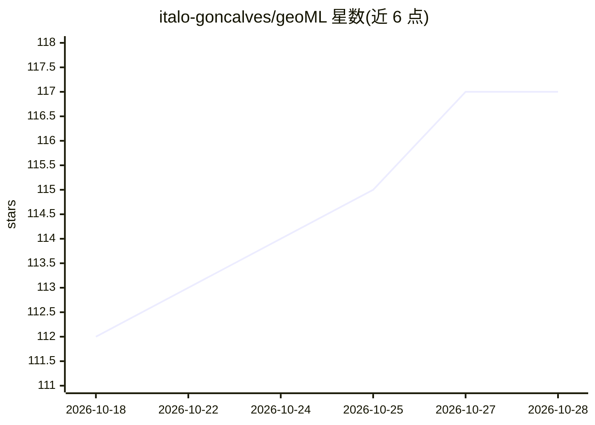

# italo-goncalves/geoML

⭐ 117 · Python · GPL-3.0 · 推送 2026-10-27 · [GitHub](https://github.com/italo-goncalves/geoML) · 个人维护

**地质空间建模 Python 库：机器学习实现空间插值与隐式建模**

面向地学（地质、采矿等）用户的 Python 包，提供带置信区间的空间插值与平滑的机器学习模型：1D/2D/3D 高斯过程（含各向异性椭球）、变分高斯过程分类与多变量建模、成分数据与方向性数据支持、基于边界数据的隐式地质建模、深度学习非平稳建模，结果导出 PyVista 格式，后端基于 TensorFlow。附带示例 notebook、教学材料与 Claude Code 插件。采用 GPL v3 与商业许可的双许可模式。

## 筛选速览

| 维度 | 判定 | 备注 |
|---|---|---|
| AI 角色 | `ai-native` | 本体是模型或模型工具 |
| 许可风险 | `dual` | GPL-3.0 |
| 部署形态 | `library` | 以包/库形式分发 |
| 模型依赖 | — | README 未给出锁定关系 |
| 硬件要求 | — | 无带数字的原话,不猜 |
| 安装摩擦 | `low` | 无编译、无系统依赖或容器化 |
| 成熟度 | `idea` | |

## 能力要点

- 1D/2D/3D 高斯过程与变分高斯过程建模，各向异性椭球支持
- 成分数据、方向性数据与边界数据隐式建模
- 非平稳建模的深度学习路径，结果导出 PyVista
- 随包提供 Claude Code 插件与系列教学 notebook

## 适用场景

- 地质隐式建模与结构趋势场建模
- 矿产品位空间插值与多变量建模
- 利用方向性数据（梯度、面理测量）做势场建模

## 场景标签

 · 领域:地学/空间统计

## 证据(README 行号)

> L13: This package contains machine learning models specialized in spatial interpolation and smoothing with calibrated co
> L26: * Back-end powered by TensorFlow.

## 星数曲线

2026-10-18 112 → 2026-10-28 117（+5）

---
*卡片 v1 · prompt 1.4 · 生成 2026-10-23 · 置信度 high · 依据 README sha `ccaf1847fae1` · [字段定义](../../DATASET.md)*
