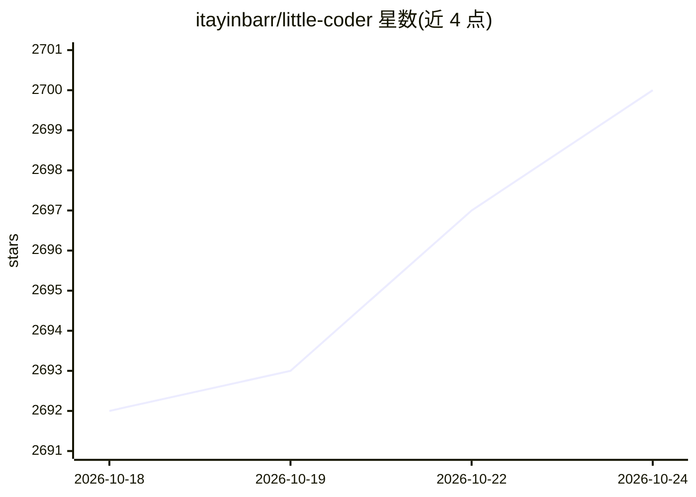

# itayinbarr/little-coder

⭐ 2,701 · TypeScript · Apache-2.0 · 推送 2026-09-18 · [GitHub](https://github.com/itayinbarr/little-coder) · [官网](https://itayinbarr.github.io/little-coder/) · 个人维护

**面向小型本地模型的终端编程代理（基于 pi 构建）**

little-coder 是构建在 pi 之上的命令行编程代理，针对小型本地模型调优：默认配置为本地 llama.cpp 服务器承载 Qwen3.6-35B-A3B，也支持 Ollama、LM Studio 及 Anthropic/OpenAI 云端模型。本体为 pi + 约 30 个扩展 + 30 个技能 markdown 文件 + Python 基准测试 harness，通过启动器以 --no-extensions 方式加载固定扩展集，保持约 7k token 的冷启动上下文。提供计划模式、深度研究、只读子代理 fan-out、后台任务、按阶段选模型等交互功能。需 Node.js 22.19+。

## 筛选速览

| 维度 | 判定 | 备注 |
|---|---|---|
| AI 角色 | `ai-native` | 本体是模型或模型工具 |
| 许可风险 | `permissive` | Apache-2.0 |
| 部署形态 | `self-host` | docker 或自建部署 |
| 模型依赖 | local-ok | 支持本地模型 |
| 硬件要求 | — | 无带数字的原话,不猜 |
| 安装摩擦 | `low` | 无编译、无系统依赖或容器化 |
| 成熟度 | — | 结构信号不足 |

## 能力要点

- 针对小模型调优，默认本地 llama.cpp + Qwen，也支持 Ollama/LM Studio/云端模型
- 固定扩展集加载，冷启动上下文约 7k token
- 计划模式（/implement 分离研究与实施上下文）、深度研究、只读子代理 dispatch
- 后台长任务与基于事件唤醒、按阶段选择计划/执行模型

## 适用场景

- 在笔记本上用小型本地模型做代码编辑与生成
- 让代理先制定计划再实施大型改动
- 对课题做外部在线研究并产出带引用的报告

## 场景标签

`编码 Agent` `科研工具` · 领域:编码与开发

## 证据(README 行号)

> L5: **A coding agent tuned for small local models, built on top of pi.**

## 星数曲线

2026-10-18 2,692 → 2026-10-24 2,700（+8）

---
*卡片 v1 · prompt 1.4 · 生成 2026-10-21 · 置信度 mid · 依据 README sha `de650884c4af` · [字段定义](../../DATASET.md)*
