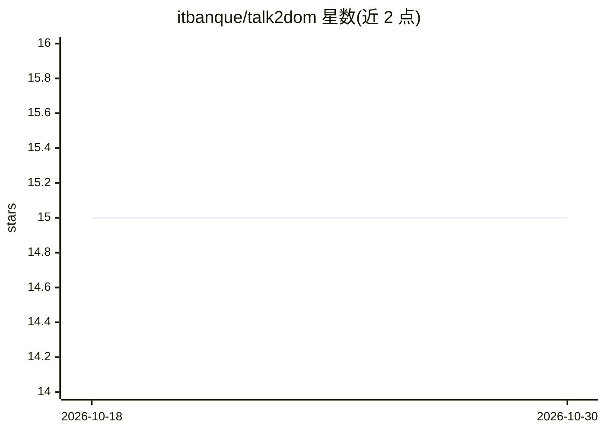

# itbanque/talk2dom

⭐ 15 · Python · AGPL-3.0 · 推送 2026-07-14 · [GitHub](https://github.com/itbanque/talk2dom) · 组织维护 · 中文 README

**用自然语言定位网页元素的 LLM 工具，输出 XPath/CSS 选择器**

面向浏览器自动化与 UI 测试场景的工具库：读取自然语言描述的意图，由 LLM 在页面 DOM（含深层 Shadow DOM）中定位正确元素，输出可执行的 XPath/CSS 选择器或浏览器操作步骤，支持多步交互的持久会话。另提供含用户认证、项目管理、API Key、订阅计费（Stripe）与基于 PostgreSQL 的选择器缓存的托管服务后端。通过 git clone 源码加 docker compose 启动，API 带 OpenAPI 文档。采用 AGPL v3 许可。

## 筛选速览

| 维度 | 判定 | 备注 |
|---|---|---|
| AI 角色 | `ai-ecosystem` | LLM/agent 周边工具 |
| 许可风险 | `viral` | AGPL-3.0 |
| 部署形态 | `self-host` | docker 或自建部署 |
| 模型依赖 | — | README 未给出锁定关系 |
| 硬件要求 | — | 无带数字的原话,不猜 |
| 安装摩擦 | `low` | 无编译、无系统依赖或容器化 |
| 成熟度 | — | 结构信号不足 |

## 能力要点

- 自然语言意图到 XPath/CSS 选择器的转换
- 支持多步交互的持久会话
- 托管版含认证、项目管理、API Key 与订阅计费系统
- 基于 PostgreSQL 的 LLM 结果缓存与去重

## 适用场景

- 自动化测试中用一句话定位目标 UI 元素
- LLM 驱动的网页导航 agent 获取可靠选择器
- 在 RPA 或内部工具中集成元素定位 API

## 场景标签

`浏览器自动化` · 领域:效率与自动化

## 证据(README 行号)

> L26: In most automated testing or LLM-driven web navigation tasks, the real challenge is not how to click or type — it's
> L44: - 🧠 LLM-powered understanding of high-level intent
> L45: - 🧩 Outputs: actionable XPath/CSS selectors or ready-to-run browser steps

## 星数曲线

2026-10-18 15 → 2026-10-30 15（+0）

---
*卡片 v1 · prompt 1.4 · 生成 2026-10-30 · 置信度 mid · 依据 README sha `6be9c644ce06` · [字段定义](../../DATASET.md)*
