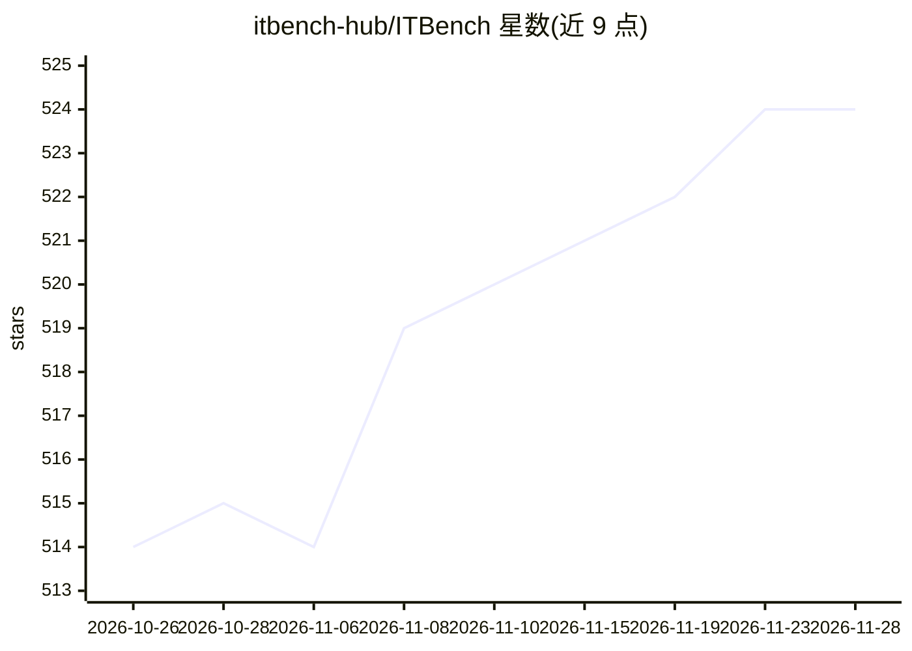

# itbench-hub/ITBench

⭐ 524 · Python · Apache-2.0 · 推送 2026-11-26 · [GitHub](https://github.com/itbench-hub/ITBench) · 组织维护

**给研究者和开发者在真实 IT 任务上评测 AI agent 的基准框架**

IBM Research 开源的 IT 自动化基准框架，覆盖 SRE（可用性）、CISO（合规与安全）、FinOps（成本效率）三类任务。通过基于 Kubernetes 的场景环境复现真实 IT 事件（6 个 SRE 场景/21 种机制、4 类 CISO 场景、1 个 FinOps 场景），提供 mise 与 ITBench CLI 的一键部署工具、两个基于 CrewAI 的基线 agent（SRE/CISO），以及托管式 leaderboard 用于提交 agent 输出并评估。研究者可在自托管环境运行，也可申请托管场景环境。

## 筛选速览

| 维度 | 判定 | 备注 |
|---|---|---|
| AI 角色 | `ai-ecosystem` | LLM/agent 周边工具 |
| 许可风险 | `permissive` | Apache-2.0 |
| 部署形态 | `None` |  |
| 模型依赖 | local-ok | 支持本地模型 |
| 硬件要求 | — | 无带数字的原话,不猜 |
| 安装摩擦 | `low` | 无编译、无系统依赖或容器化 |
| 成熟度 | — | 结构信号不足 |

## 能力要点

- 覆盖 SRE/CISO/FinOps 三类 IT 自动化任务的场景集（含 21 种故障机制）
- Kubernetes 环境中一键部署场景的 ITBench CLI 工具链
- 基于 CrewAI 的两个开源基线 agent，支持 watsonx/Azure/vLLM 可配置 LLM
- 托管 leaderboard 跟踪 agent 性能对比

## 适用场景

- 在复现的 Kubernetes 故障场景中评测我的 SRE agent
- 将 agent 输出提交到 ITBench leaderboard 参与排名
- 在合规与安全任务上测试企业自动化 agent

## 场景标签

`模型评测` `网络安全` · 领域:评测与运维

## 证据(README 行号)

> L22: ITBench measures the performance of AI agents across a wide variety of **complex and real-world inspired IT automat
> L44: 1. **Push-button deployment tooling** for environment setup using mise and the ITBench CLI *(open-source)*
> L58: The ITBench Leaderboard tracks agent performance across SRE, FinOps, and CISO scenarios. We provide fully managed s

## 星数曲线

2026-10-26 514 → 2026-11-28 524（+10）

---
*卡片 v1 · prompt 1.4 · 生成 2026-11-25 · 置信度 high · 依据 README sha `5378635a3f06` · [字段定义](../../DATASET.md)*
