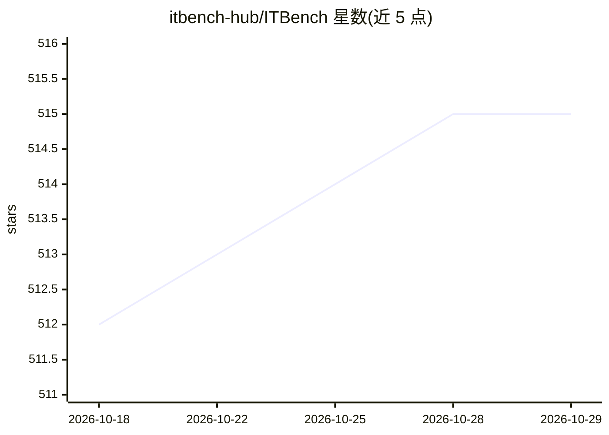

# itbench-hub/ITBench

⭐ 515 · Python · Apache-2.0 · 推送 2026-10-28 · [GitHub](https://github.com/itbench-hub/ITBench) · 组织维护

**评测 AI agent 在 IT 自动化任务表现的基准框架**

IBM Research 维护的开源基准框架，评测 AI agent 在 SRE（可靠性）、CISO（合规与安全）、FinOps（成本优化）三类 IT 自动化任务上的表现。基于 Kubernetes 部署场景环境，提供一键部署工具、6 个 SRE 场景与 21 种机制、4 类 CISO 场景、1 个 FinOps 场景，以及两个基于 CrewAI 构建的开源基线 agent（支持 watsonx/Azure/vLLM 配置），并托管 leaderboard 供提交评估。ICML 2025 论文已发表。

## 筛选速览

| 维度 | 判定 | 备注 |
|---|---|---|
| AI 角色 | `ai-ecosystem` | LLM/agent 周边工具 |
| 许可风险 | `permissive` | Apache-2.0 |
| 部署形态 | `None` |  |
| 模型依赖 | local-ok | 支持本地模型 |
| 硬件要求 | — | 无带数字的原话,不猜 |
| 安装摩擦 | `low` | 无编译、无系统依赖或容器化 |
| 成熟度 | — | 结构信号不足 |

## 能力要点

- 覆盖 SRE/CISO/FinOps 三类 IT 自动化任务的场景库
- Kubernetes 场景环境与一键部署工具
- 两个基于 CrewAI 的开源基线 agent（SRE 与 CISO）
- 托管 leaderboard 用于 agent 评估与对比

## 适用场景

- 在真实 Kubernetes 故障场景中评测我的 agent
- 研究 IT 自动化 agent 的失败模式与能力边界
- 在 leaderboard 上提交 agent 输出与其他方案对比

## 场景标签

`模型评测` · 领域:评测与运维

## 证据(README 行号)

> L22: ITBench measures the performance of AI agents across a wide variety of **complex and real-world inspired IT automat
> L41: ITBench enables researchers and developers to replicate real-world incidents in Kubernetes environments and develop
> L58: The ITBench Leaderboard tracks agent performance across SRE, FinOps, and CISO scenarios. We provide fully managed s

## 星数曲线

2026-10-18 512 → 2026-10-29 515（+3）

---
*卡片 v1 · prompt 1.4 · 生成 2026-10-21 · 置信度 high · 依据 README sha `5b5b74524f1f` · [字段定义](../../DATASET.md)*
