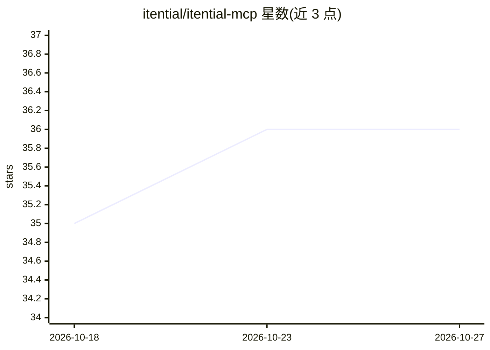

# itential/itential-mcp

⭐ 36 · Python · GPL-3.0 · 推送 2026-10-19 · [GitHub](https://github.com/itential/itential-mcp) · 组织维护

**连接 LLM 与 Itential 网络自动化平台的 MCP 服务器**

Itential 官方维护的 Model Context Protocol 服务器，向 AI 助手暴露 79 个工具（默认启用 78 个、1 个实验性），覆盖网络设备配置、命令执行、合规管理、工作流编排与执行监控、平台健康监控、组件生命周期、资源模型管理等 13 个标签类别。要求 Python 3.10+ 并可访问 Itential Platform 实例，支持 basic/OAuth 2.0/JWT 认证，提供 stdio 与 HTTP（Streamable HTTP）传输，SSE 已标记弃用；可经 pip、源码或 GHCR 容器镜像安装运行，并通过标签体系与角色配置控制可用工具。

## 筛选速览

| 维度 | 判定 | 备注 |
|---|---|---|
| AI 角色 | `ai-ecosystem` | LLM/agent 周边工具 |
| 许可风险 | `viral` | GPL-3.0 |
| 部署形态 | `self-host` | docker 或自建部署 |
| 模型依赖 | — | README 未给出锁定关系 |
| 硬件要求 | — | 无带数字的原话,不猜 |
| 安装摩擦 | `low` | 无编译、无系统依赖或容器化 |
| 成熟度 | — | 结构信号不足 |

## 能力要点

- 79 个自动化工具，覆盖 13 个标签类别
- stdio / HTTP（Streamable HTTP）传输，SSE 已弃用
- 标签过滤与按角色（管理员/网络工程师/开发者）裁剪工具集
- 支持 basic auth / OAuth 2.0 / JWT 认证与容器化部署

## 适用场景

- 让 AI 助手管理 Itential Platform 上的网络自动化与工作流
- 通过 MCP 客户端监控平台健康与执行作业状态
- 按角色配置裁剪暴露给模型的工具集合

## 场景标签

`工作流自动化` · 领域:效率与自动化

## 证据(README 行号)

> L10: A Model Context Protocol _(MCP)_ server that provides comprehensive tools for connecting LLMs to Itential Platform.
> L23: - **79 Automation Tools** (78 enabled by default; 1 experimental tool is opt-in): Comprehensive toolkit across 13 t

## 星数曲线

2026-10-18 35 → 2026-10-27 36（+1）

---
*卡片 v1 · prompt 1.4 · 生成 2026-10-25 · 置信度 high · 依据 README sha `19d50971c46e` · [字段定义](../../DATASET.md)*
