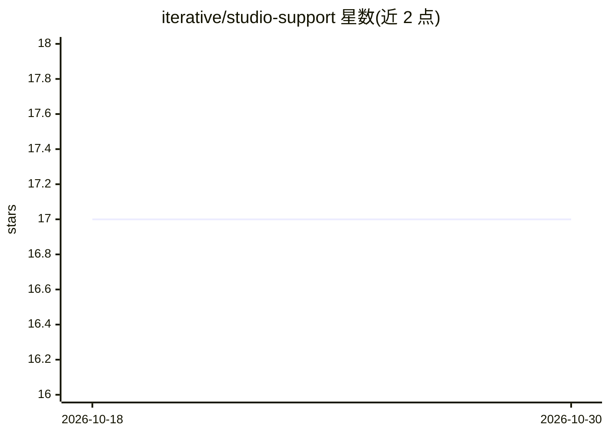

# iterative/studio-support

⭐ 17 · 推送 2026-03-17 · [GitHub](https://github.com/iterative/studio-support) · [官网](https://studio.iterative.ai) · 组织维护

**DVC Studio 的问题反馈与讨论收集仓库**

iterative 组织下的支持类仓库：不含源代码，专门用于收集用户对 DVC Studio（数据科学与机器学习实验管理工具）的 bug 报告、问题与功能建议。用户通过在此创建 issue 提交反馈，维护方承诺尽快处理。仓库本身不提供安装、运行方式，也不包含任何功能实现代码。

## 筛选速览

| 维度 | 判定 | 备注 |
|---|---|---|
| AI 角色 | `ai-ecosystem` | LLM/agent 周边工具 |
| 许可风险 | `none` | — |
| 部署形态 | `None` |  |
| 模型依赖 | — | README 未给出锁定关系 |
| 硬件要求 | — | 无带数字的原话,不猜 |
| 安装摩擦 | `low` | 无编译、无系统依赖或容器化 |
| 成熟度 | — | 结构信号不足 |

## 能力要点

- 作为 DVC Studio 的 bug 与功能建议收集渠道
- 仓库明确声明不包含源代码
- 由 iterative 组织维护

## 适用场景

- 为 DVC Studio 提交 bug 报告
- 向开发方提出功能建议或使用问题

## 场景标签

 · 领域:MLOps/工具支持

## 证据(README 行号)

> L5: This repository doesn't contain source code, it's made specifically as a place
> L6: to collect feedback about bugs, new features, etc.

## 星数曲线

2026-10-18 17 → 2026-10-30 17（+0）

---
*卡片 v1 · prompt 1.4 · 生成 2026-10-29 · 置信度 low · 依据 README sha `c0f0a6f6969f` · [字段定义](../../DATASET.md)*
