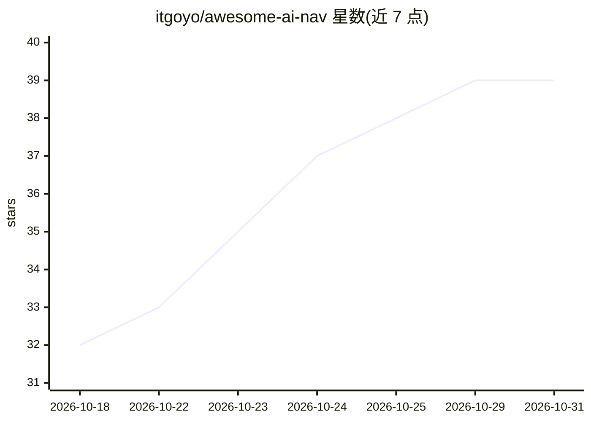

# itgoyo/awesome-ai-nav

⭐ 39 · 推送 2026-07-08 · [GitHub](https://github.com/itgoyo/awesome-ai-nav) · [官网](https://ai.0xnav.com) · 个人维护 · 中文 README

**AI 工具导航清单：分门别类收录数百个国内外 AI 工具站点**

以 README 形式维护的 AI 工具导航清单，并链接到在线导航站 ai.0xnav.com。可见部分按 AI 写作工具、AI 图像工具、AI 视频工具等大类组织，每个条目给出工具名称、一句话简介与访问链接，覆盖写作、修图/抠图、绘画生成、3D 生成、电商商拍、无损放大等细分场景，收录讯飞、美图、稿定、Midjourney、Civitai 等国内外产品。条目为链接列表形态，不含安装或运行代码。

## 筛选速览

| 维度 | 判定 | 备注 |
|---|---|---|
| AI 角色 | `ai-knowledge` | 知识聚合/清单类 |
| 许可风险 | `none` | — |
| 部署形态 | `None` |  |
| 模型依赖 | — | README 未给出锁定关系 |
| 硬件要求 | — | 无带数字的原话,不猜 |
| 安装摩擦 | `low` | 无编译、无系统依赖或容器化 |
| 成熟度 | — | 结构信号不足 |

## 能力要点

- 按写作/图像/视频等类别组织的分级工具清单，每条含名称+简介+链接
- 单个类别下条目数量多（如 AI 写作 90 条、AI 图像 182 条）
- 同时收录国内（讯飞、美图、稿定、即梦）与国外（Midjourney、QuillBot、Grammarly）工具

## 适用场景

- 按类别浏览和查找可用的 AI 写作或图像处理工具
- 了解某一细分方向（如 AI 抠图、无损放大）有哪些产品可选
- 通过配套在线导航站 ai.0xnav.com 访问工具官网

## 场景标签

`精选清单` · 领域:学习与行业

## 证据(README 行号)

> L1: AI导航站：https://ai.0xnav.com
> L3: ## AI写作工具
> L545: ## AI图像工具
> L1639: ## AI视频工具

## 星数曲线

2026-10-18 32 → 2026-10-31 39（+7）

---
*卡片 v1 · prompt 1.4 · 生成 2026-10-25 · 置信度 high · 依据 README sha `4e205d9bc8be` · [字段定义](../../DATASET.md)*
