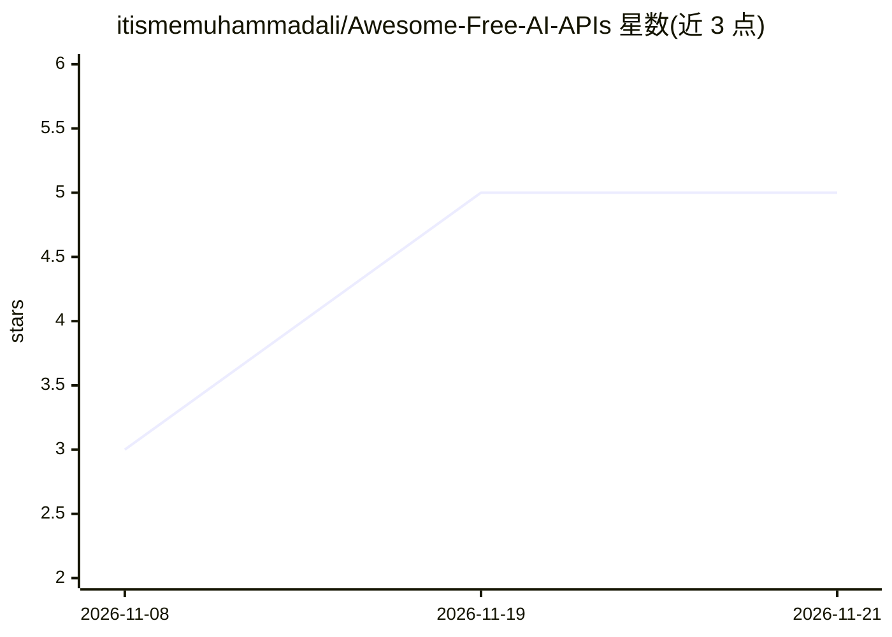

# itismemuhammadali/Awesome-Free-AI-APIs

⭐ 5 · Python · MIT · 推送 2026-10-22 · [GitHub](https://github.com/itismemuhammadali/Awesome-Free-AI-APIs) · 个人维护

**面向开发者的180+免费AI API与免费额度目录清单**

社区维护的策展清单，收录180+提供免费额度或免费开发者额度的AI API平台，按LLM与多模态模型、统一路由/网关、图像生成与视觉、语音、向量数据库、网页抓取、代码助手、文档AI、视频/3D等类别组织。每个条目列出可用模型、免费额度限制、是否需信用卡及注册入口。定位为开发者目录资源，本身不提供API服务，需另行注册各平台获取密钥。

## 筛选速览

| 维度 | 判定 | 备注 |
|---|---|---|
| AI 角色 | `ai-knowledge` | 知识聚合/清单类 |
| 许可风险 | `permissive` | MIT |
| 部署形态 | `None` |  |
| 模型依赖 | — | README 未给出锁定关系 |
| 硬件要求 | — | 无带数字的原话,不猜 |
| 安装摩擦 | `low` | 无编译、无系统依赖或容器化 |
| 成熟度 | — | 结构信号不足 |

## 能力要点

- 收录180+提供免费额度的AI API平台
- 按LLM、网关、视觉、语音等类别组织条目
- 每条标注免费额度限制与是否需信用卡

## 适用场景

- 零成本搭建副项目或黑客松原型时查找免费API
- 为多Agent框架选配免费额度的模型服务商
- 对比各平台免费额度后再注册账号

## 场景标签

`精选清单` · 领域:学习与行业

## 证据(README 行号)

> L13: **The definitive, community-curated directory of 180+ AI APIs offering 100% Free Tiers, Free Credits, or Generous D
> L24: This repository catalogs **180+ verified platforms** offering free developer access across LLMs, Unified Gateways, 

## 星数曲线

2026-11-08 3 → 2026-11-21 5（+2）

---
*卡片 v1 · prompt 1.4 · 生成 2026-11-21 · 置信度 high · 依据 README sha `5c94bc3e4d19` · [字段定义](../../DATASET.md)*
