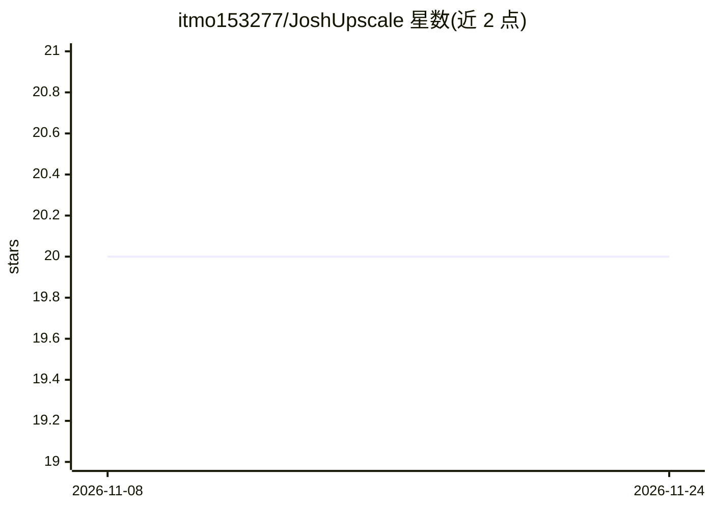

# itmo153277/JoshUpscale

⭐ 20 · Python · MIT · 推送 2026-11-03 · [GitHub](https://github.com/itmo153277/JoshUpscale) · 个人维护

**面向 PSP 版 GTA 视频的 AI 超分辨率插件集（480x270→1080p）**

基于 TensorFlow（模型源自 TecoGAN）训练的视频超分项目，针对 Grand Theft Auto: Vice City Stories (PSP) 训练，将 480x270 提升至 1920x1080。仓库包含三个部分：AviSynth 视频超分插件、OBS 实时超分插件、模型训练脚本与工具（支持 CPU/GPU/TPU 训练）。推理依赖 NVIDIA CUDA Toolkit 与 TensorRT SDK，需通过 CMake 自行编译，模型需转换为 TensorRT 格式后放入 obs_plugin/data。提供 PSP 与 PS2 各两档（质量/性能）模型。

## 筛选速览

| 维度 | 判定 | 备注 |
|---|---|---|
| AI 角色 | `ai-native` | 本体是模型或模型工具 |
| 许可风险 | `permissive` | MIT |
| 部署形态 | `None` |  |
| 模型依赖 | — | README 未给出锁定关系 |
| 硬件要求 | — | 无带数字的原话,不猜 |
| 安装摩擦 | `high` | 编译与系统依赖俱全 |
| 成熟度 | — | 结构信号不足 |

## 能力要点

- AviSynth 离线超分插件与 OBS 实时超分插件
- 训练脚本支持 CPU/GPU/TPU，可用低清/高清图像对训练
- PSP 与 PS2 各提供质量与性能两种 TensorRT 模型

## 适用场景

- 把 PSP 模拟画面实时放大到 1080p 用于直播录制
- 用 AviSynth 对已录制视频做 AI 超分
- 基于自己的数据集训练或微调超分模型

## 场景标签

`图像视频处理` · 领域:感知与多模态

## 证据(README 行号)

> L3: Upscales and refines video (480x270 -> 1920x1080) using AI model.
> L14: - avisynth plugin for video upscaling;
> L15: - OBS plugin for upscaling in real time;

## 星数曲线

2026-11-08 20 → 2026-11-24 20（+0）

---
*卡片 v1 · prompt 1.4 · 生成 2026-11-18 · 置信度 high · 依据 README sha `50798790b597` · [字段定义](../../DATASET.md)*
