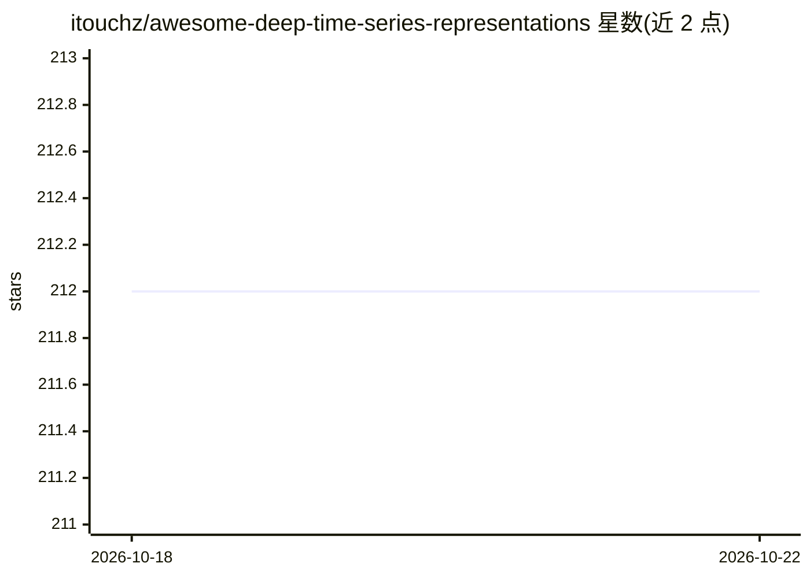

# itouchz/awesome-deep-time-series-representations

⭐ 212 · MIT · 推送 2026-08-16 · [GitHub](https://github.com/itouchz/awesome-deep-time-series-representations) · [官网](https://itouchz.github.io/awesome-deep-time-series-representations/) · 组织维护

**时序表示学习论文策展清单，配套 ACM CSUR 综述**

KAIST 团队维护的论文清单仓库，配套论文《Universal Time-Series Representation Learning: A Survey》（已被 ACM Computing Surveys 接收，arXiv 有扩展版）。内容按提议的分类法组织：相关工作综述表（覆盖时序数据挖掘、异常检测、基础模型等方向，含标题/机构/发表venue/年份）、以及按数据为中心（data-centric）等方法类别收录的研究论文表。仓库计划跟随顶会发表周期（至 NeurIPS 2026）定期更新，读者可通过 issue/PR 补充论文。面向时序深度学习研究者。

## 筛选速览

| 维度 | 判定 | 备注 |
|---|---|---|
| AI 角色 | `ai-knowledge` | 知识聚合/清单类 |
| 许可风险 | `permissive` | MIT |
| 部署形态 | `None` |  |
| 模型依赖 | — | README 未给出锁定关系 |
| 硬件要求 | — | 无带数字的原话,不猜 |
| 安装摩擦 | `low` | 无编译、无系统依赖或容器化 |
| 成熟度 | — | 结构信号不足 |

## 能力要点

- 配套论文被 ACM Computing Surveys 接收，arXiv 有扩展版
- 相关工作综述表含标题、机构、发表 venue、年份
- 按提议分类法（如数据为中心方法）组织研究论文
- 计划按顶会周期定期更新至 NeurIPS 2026，接受 issue/PR 补充

## 适用场景

- 查找时序表示学习方向的论文与相关工作
- 调研时序深度学习各分支已有的综述覆盖
- 为写作综述或选型模型时追溯方法出处

## 场景标签

 · 领域:机器学习/时间序列研究

## 证据(README 行号)

> L3: This repository is intended to help readers interested in learning universal representations of time series with dee
> L12: **Accompanying Paper**: Universal Time-Series Representation Learning: A Survey, Extended Version on arXiv.

## 星数曲线

2026-10-18 212 → 2026-10-22 212（+0）

---
*卡片 v1 · prompt 1.4 · 生成 2026-10-22 · 置信度 high · 依据 README sha `c529cc081194` · [字段定义](../../DATASET.md)*
