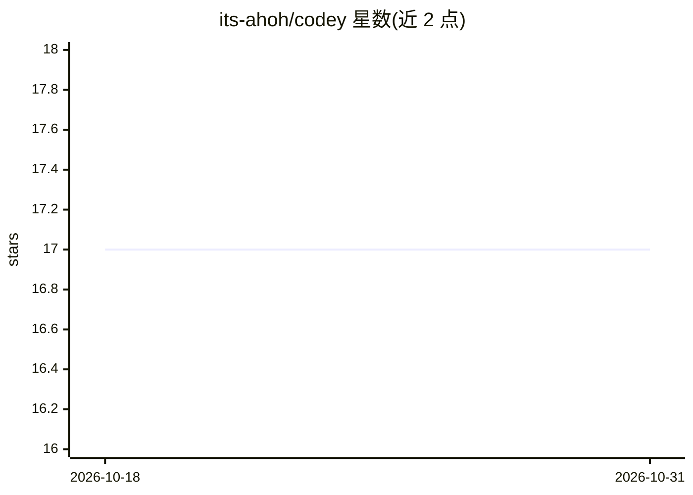

# its-ahoh/codey

⭐ 17 · TypeScript · MIT · 推送 2026-10-30 · [GitHub](https://github.com/its-ahoh/codey) · [官网](https://its-ahoh.github.io/codey/) · 个人维护 · 中文 README

**给开发者的多编码 agent 编排工作台，统一管理 Claude Code/Codex 等**

运行在本机 macOS 上的多 agent 工作台，通过调用用户已安装的 agent CLI（Claude Code、Codex、OpenCode、pi）实现编排：每项目独立工作区、可复用的 bot 团队、同一提示并行运行多个 agent 对比、流程图分支执行、定时自动化、agent 控制的浏览器与外部 MCP 服务器接入。界面包括 macOS 菜单栏应用、Telegram/Discord/iMessage 聊天平台接入以及基于 WhisperKit 的本地语音输入。网关为 Node.js，桌面应用与语音功能仅限 macOS。

## 筛选速览

| 维度 | 判定 | 备注 |
|---|---|---|
| AI 角色 | `ai-ecosystem` | LLM/agent 周边工具 |
| 许可风险 | `permissive` | MIT |
| 部署形态 | `desktop` | 安装包/桌面程序 |
| 模型依赖 | — | README 未给出锁定关系 |
| 硬件要求 | — | 无带数字的原话,不猜 |
| 安装摩擦 | `low` | 无编译、无系统依赖或容器化 |
| 成熟度 | — | 结构信号不足 |

## 能力要点

- 并行运行多个编码 agent 并对比结果
- bot 团队 + 流程图（judge LLM 选边）与自动调度
- Telegram/Discord/iMessage 远程接入与 QR 配对
- 本地 WhisperKit 语音转写（CoreML/ANE，无需网络与 API key）

## 适用场景

- 在同一项目里按任务切换并编排多个编码 agent
- 通过手机聊天软件远程给本机 agent 派任务
- 把 agent 定时任务和 agent 控制的浏览器组合成自动化流程

## 场景标签

`多智能体` · 领域:Agent 开发

## 证据(README 行号)

> L12: **A multi-agent workbench for coding agents.** Codey is one place to organize, switch between, and orchestrate Clau
> L14: Think of it less as a chat bridge and more as **the control plane for the coding agents you already use**. It runs 
> L255: **Does Codey replace Claude Code / Codex / OpenCode?**

## 星数曲线

2026-10-18 17 → 2026-10-31 17（+0）

---
*卡片 v1 · prompt 1.4 · 生成 2026-10-29 · 置信度 high · 依据 README sha `194b3cdb4a68` · [字段定义](../../DATASET.md)*
