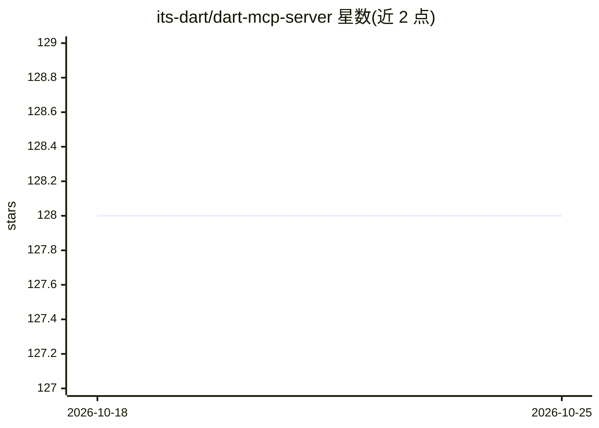

# its-dart/dart-mcp-server

⭐ 128 · TypeScript · MIT · 推送 2026-09-09 · [GitHub](https://github.com/its-dart/dart-mcp-server) · 组织维护

**Dart AI 项目管理工具的官方 MCP 服务器（已弃用本地版）**

Dart（AI 驱动的项目管理产品）的官方 Model Context Protocol 服务器，向 AI 客户端暴露任务与文档管理能力：提供 create-task、create-doc、summarize-tasks 等 prompts，get_config、list/create/update/delete_task、add_task_comment 等 14 个工具，以及配置、任务、文档三类资源模板，工具返回结构化 JSON 并带输入校验。通过 npx 运行或 Docker 部署，需 Dart 认证 token，支持 Claude Desktop、Claude Code、Cursor、Cline、Windsurf 等客户端。注意：README 顶部声明本地 MCP 服务器已弃用，推荐改用官方托管的 hosted 版本。

## 筛选速览

| 维度 | 判定 | 备注 |
|---|---|---|
| AI 角色 | `ai-ecosystem` | LLM/agent 周边工具 |
| 许可风险 | `permissive` | MIT |
| 部署形态 | `self-host` | docker 或自建部署 |
| 模型依赖 | — | README 未给出锁定关系 |
| 硬件要求 | — | 无带数字的原话,不猜 |
| 安装摩擦 | `low` | 无编译、无系统依赖或容器化 |
| 成熟度 | — | 结构信号不足 |

## 能力要点

- 14 个任务与文档管理 MCP 工具，返回结构化 JSON 并带输入校验
- 提供 prompts 与 dart-task/dart-doc 资源模板
- npx 一键运行，Docker 部署为备选方案
- 覆盖 Claude Desktop/Claude Code/Cursor/Cline/Windsurf 客户端配置说明

## 适用场景

- 在 AI 编程助手中直接创建、查询、更新 Dart 任务与文档
- 让 AI 助手汇总项目任务状态与分配情况
- 将 Dart 项目管理接入任意支持 MCP 的客户端

## 场景标签

 · 领域:开发工具/项目管理

## 证据(README 行号)

> L12: `dart-mcp-server` is the official AI Model Context Protocol (MCP) server for Dart.
> L16: ## Features

## 星数曲线

2026-10-18 128 → 2026-10-25 128（+0）

---
*卡片 v1 · prompt 1.4 · 生成 2026-10-22 · 置信度 high · 依据 README sha `d0aba322c656` · [字段定义](../../DATASET.md)*
