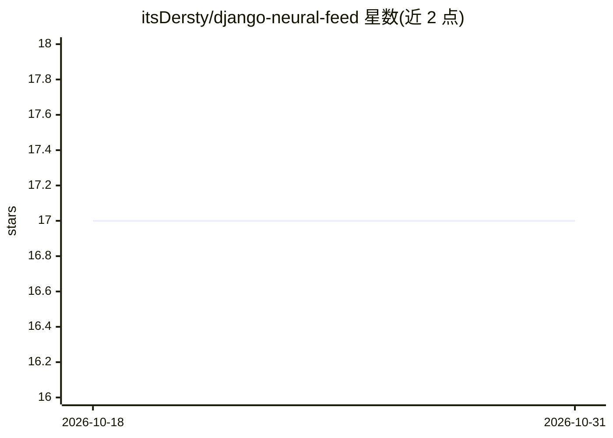

# itsDersty/django-neural-feed

⭐ 17 · Python · MIT · 推送 2026-06-19 · [GitHub](https://github.com/itsDersty/django-neural-feed) · 个人维护

**Django 个性化内容推荐库：基于 pgvector 语义向量生成信息流**

以 pip 包提供的 Django 应用：通过 Mixin 向现有内容模型注入向量嵌入列，用 sentence-transformers（默认 paraphrase-multilingual-MiniLM-L12-v2）生成嵌入，PostgreSQL pgvector 在数据库层计算余弦相似度，并与新鲜度、自定义热度表达式合成为单一 SQL 注解完成混合排序。通过 Django 信号非侵入式跟踪用户互动，维护按 feed 分区的用户向量画像；Celery 异步执行，broker 离线时回退同步线程。支持 HNSW 索引与自定义云端编码器（OpenAI/Cohere）。要求 Python 3.10+、Django 4.2+、PostgreSQL 12+ 且安装 pgvector 扩展。

## 筛选速览

| 维度 | 判定 | 备注 |
|---|---|---|
| AI 角色 | `ai-native` | 本体是模型或模型工具 |
| 许可风险 | `permissive` | MIT |
| 部署形态 | `library` | 以包/库形式分发 |
| 模型依赖 | — | README 未给出锁定关系 |
| 硬件要求 | — | 无带数字的原话,不猜 |
| 安装摩擦 | `low` | 无编译、无系统依赖或容器化 |
| 成熟度 | — | 结构信号不足 |

## 能力要点

- pgvector 数据库层余弦相似度 + 新鲜度 + 热度的单查询混合评分
- Mixin 方式为现有模型注入向量列，不改动既有互动表
- Celery 异步管道，broker 离线时自动回退同步线程
- HNSW 近似最近邻索引支持（README 称 10k+ 条目场景）

## 适用场景

- 为我的 Django 站点内容（文章/视频等）添加个性化推荐流
- 多模型/多租户场景下按 Feed 类隔离配置与用户画像
- 大规模数据集下启用 HNSW 索引加速向量检索

## 场景标签

`推荐系统` `语义搜索` · 领域:知识与检索

## 证据(README 行号)

> L27: **Django Neural Feed (DNF)** is a production-ready Django application designed to build intelligent, personalized c
> L36: - **🎯 Hybrid Multi-Criteria Scoring**: Merges semantic similarity (pgvector cosine distance), content recency, and 

## 星数曲线

2026-10-18 17 → 2026-10-31 17（+0）

---
*卡片 v1 · prompt 1.4 · 生成 2026-10-29 · 置信度 high · 依据 README sha `e5d62906c6cc` · [字段定义](../../DATASET.md)*
