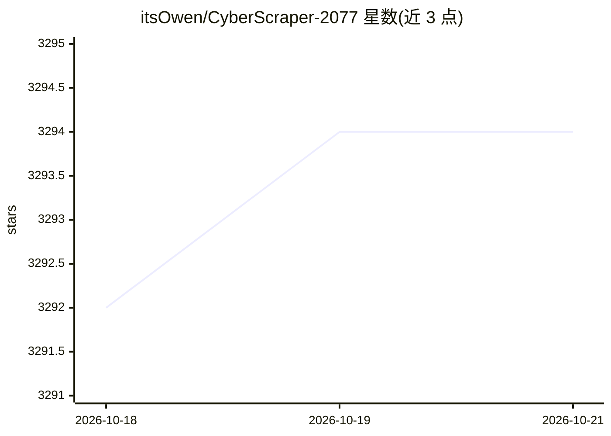

# itsOwen/CyberScraper-2077

⭐ 3,297 · Python · MIT · 推送 2026-10-12 · [GitHub](https://github.com/itsOwen/CyberScraper-2077) · 个人维护

**面向数据提取者的 AI 驱动网页抓取工具，支持多格式导出**

基于 Playwright 与 LLM 的网页数据提取应用：用户提供 URL 或自然语言提问，由 OpenAI、Gemini、本地 Ollama 模型或 LiteLLM 代理解析并结构化网页内容，输出 JSON/CSV/HTML/SQL/Excel，并可上传 Google Sheets。支持多页范围抓取（BETA）、Tor 网络抓取 .onion 站点、隐身参数与验证码绕过。以 Streamlit 网页界面提供，通过 git clone 源码或 Docker 安装，需 Python 3.10+ 与 Playwright；Windows 用户被指引使用 Docker。

## 筛选速览

| 维度 | 判定 | 备注 |
|---|---|---|
| AI 角色 | `ai-enhanced` | 去掉 AI 部分产品仍成立 |
| 许可风险 | `permissive` | MIT |
| 部署形态 | `self-host` | docker 或自建部署 |
| 模型依赖 | local-ok | 支持本地模型 |
| 硬件要求 | — | 无带数字的原话,不猜 |
| 安装摩擦 | `low` | 无编译、无系统依赖或容器化 |
| 成熟度 | `idea` | |

## 能力要点

- OpenAI / Gemini / Ollama 本地模型 / LiteLLM 代理多种 LLM 后端
- 多页范围抓取（支持 URL 模式与自定义页码范围，BETA）
- Tor 网络自动路由抓取 .onion 站点（可配置 SOCKS 端口与电路隔离）
- 导出 JSON/CSV/HTML/SQL/Excel 并一键上传 Google Sheets

## 适用场景

- 用自然语言描述要抽取的数据并从网页导出结构化结果
- 批量抓取分页列表或搜索结果页
- 经 Tor 网络访问并提取 .onion 站点数据

## 场景标签

`网页抓取` · 领域:效率与自动化

## 证据(README 行号)

> L23: CyberScraper 2077 is not just another web scraping tool – it's a glimpse into the future of data extraction. Born f
> L29: - **AI-Powered Extraction**: Utilizes cutting-edge AI models to understand and parse web content intelligently.
> L34: - **Ollama Support**: Use a huge library of open source LLMs.

## 星数曲线

2026-10-18 3,292 → 2026-10-21 3,294（+2）

---
*卡片 v1 · prompt 1.4 · 生成 2026-10-21 · 置信度 mid · 依据 README sha `8de3f4b97ebb` · [字段定义](../../DATASET.md)*
