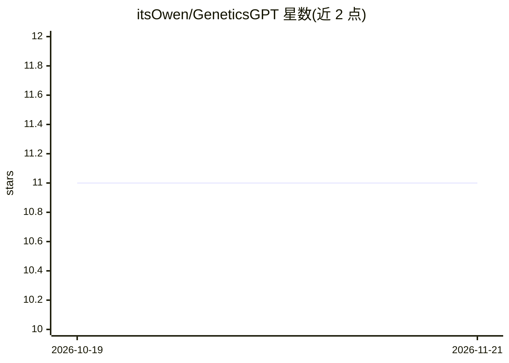

# itsOwen/GeneticsGPT

⭐ 11 · Python · MIT · 推送 2026-09-27 · [GitHub](https://github.com/itsOwen/GeneticsGPT) · 个人维护

**面向遗传学/疾病研究者的自然语言查询 Open Targets 数据库工具**

基于 PyQt5 的桌面应用，调用 OpenAI GPT-3.5-turbo 将自然语言问题转换为 GraphQL 查询，访问 Open Targets 遗传学数据库并返回答案；同时根据查询响应生成常见问题列表，点击单个 FAQ 可获得简明回答。README 说明运行需 Python 3.7+、OpenAI API key、PyQt5 与 requests 库，以 MIT 许可发布。

## 筛选速览

| 维度 | 判定 | 备注 |
|---|---|---|
| AI 角色 | `ai-native` | 本体是模型或模型工具 |
| 许可风险 | `permissive` | MIT |
| 部署形态 | `None` |  |
| 模型依赖 | — | README 未给出锁定关系 |
| 硬件要求 | — | 无带数字的原话,不猜 |
| 安装摩擦 | `low` | 无编译、无系统依赖或容器化 |
| 成熟度 | — | 结构信号不足 |

## 能力要点

- 将自然语言查询转换为 Open Targets GraphQL 查询
- 基于 GPT-3.5-turbo 生成遗传学/疾病问题的回答
- 自动生成 FAQ 列表并支持点击查看简明回答
- PyQt5 图形界面，通过 python main.py 运行

## 适用场景

- 用自然语言查询遗传学与疾病相关数据
- 药物发现研究中检索 Open Targets 数据集
- 生成并浏览遗传问题的 FAQ 解答

## 场景标签

`科研工具` · 领域:学习与行业

## 证据(README 行号)

> L3: GeneticsGPT is a powerful and intuitive application that leverages the OpenAI GPT-3.5-turbo model to provide insight
> L12: - 🔍 Get detailed answers based on the Open Targets genetics database
> L53: GeneticsGPT is a GPT-based search engine to translate natural language queries into valid GraphQL queries. This emp

## 星数曲线

2026-10-19 11 → 2026-11-21 11（+0）

---
*卡片 v1 · prompt 1.4 · 生成 2026-11-18 · 置信度 high · 依据 README sha `d9ec55f5bad5` · [字段定义](../../DATASET.md)*
