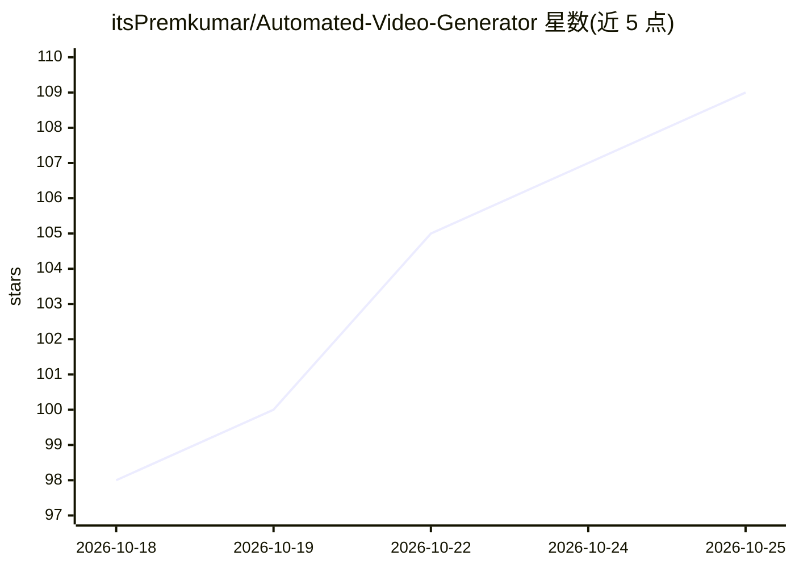

# itsPremkumar/Automated-Video-Generator

⭐ 109 · TypeScript · MIT · 推送 2026-09-11 · [GitHub](https://github.com/itsPremkumar/Automated-Video-Generator) · [官网](https://itspremkumar.github.io/Automated-Video-Generator/) · 个人维护

**本地自托管的文本转视频全自动流水线：脚本进、配音成片出**

自托管的开源流水线：读取文本脚本或 JSON 任务，自动获取免费素材（Openverse/Wikimedia，配置 Pexels key 可提升相关性），用内置 Voicebox（Kokoro/Chatterbox）或 Edge-TTS 生成 400+ 声音的旁白，经 Remotion 渲染并烧录字幕，输出 MP4 与缩略图；无需 API key 即可运行。提供 Windows 桌面安装包、一键启动器、Docker 镜像、Web 门户与 MCP 服务器（61 工具，可接入 Claude Desktop/Cursor 等 agent，默认安全模式）。附带 20+ 单任务剪辑操作、ComfyUI/CogVideoX 本地生成与 Ollama/Gemini 视觉校验等可选能力。

## 筛选速览

| 维度 | 判定 | 备注 |
|---|---|---|
| AI 角色 | `ai-native` | 本体是模型或模型工具 |
| 许可风险 | `permissive` | MIT |
| 部署形态 | `desktop` | 安装包/桌面程序 |
| 模型依赖 | local-ok | 支持本地模型 |
| 硬件要求 | `gpu-24g` | |
| 安装摩擦 | `low` | 无编译、无系统依赖或容器化 |
| 成熟度 | — | 结构信号不足 |

## 能力要点

- 脚本→素材→旁白→渲染的本地流水线，无 API key 默认可运行
- Windows 桌面安装包、Docker 镜像、CLI 批量、Web 门户、MCP 服务器多种使用方式
- 内置 Voicebox TTS（Kokoro/Chatterbox）+ Edge-TTS 降级，支持语音克隆
- MCP 暴露 61 工具，默认安全模式阻止 agent 写操作

## 适用场景

- 把写好的脚本批量生成为带配音和字幕的短视频/横屏视频
- 通过 Claude Desktop 或 Cursor 等 agent 用自然语言驱动视频制作
- 发布到 TikTok/Instagram/YouTube 前的本地成片渲染

## 场景标签

`视频生成` · 领域:内容生成

## 证据(README 行号)

> L18: **Automated Video Generator** is a free, open-source, self-hosted pipeline that converts text scripts into polished
> L27:  Parse → Fetch media → Generate voiceover → Render with Remotion

## 星数曲线

2026-10-18 98 → 2026-10-25 109（+11）

---
*卡片 v1 · prompt 1.4 · 生成 2026-10-23 · 置信度 high · 依据 README sha `8a436a86c77d` · [字段定义](../../DATASET.md)*
