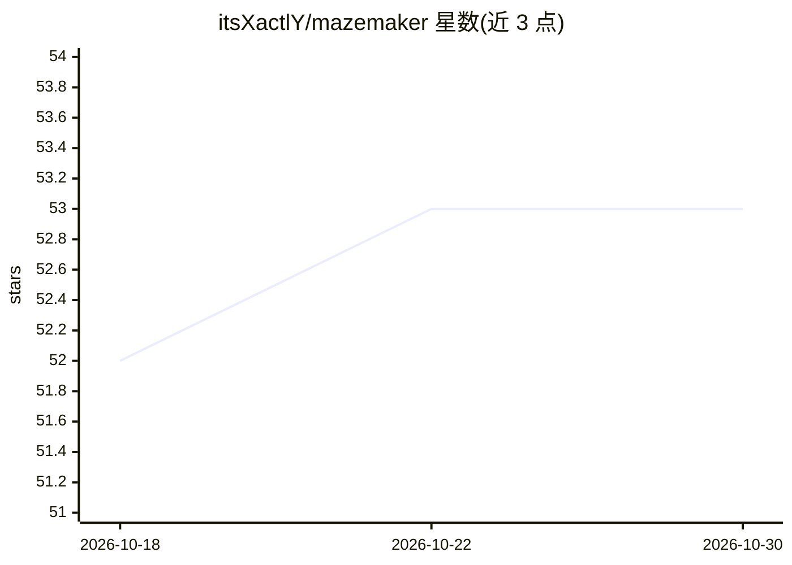

# itsXactlY/mazemaker

⭐ 53 · Python · NOASSERTION · 推送 2026-09-15 · [GitHub](https://github.com/itsXactlY/mazemaker) · [官网](https://mazemaker.online) · 个人维护

**给 AI agent 的持久语义记忆层：知识图谱+梦整理**

面向 MCP agent 与 Hermes Agent 的持久记忆系统：将对话转化为原子事实与语义链接构成的知识图谱，通过扩散激活、Personalized PageRank、ColBERT 重排做召回；空闲时运行后台“梦整理”（NREM 边强化/剪枝、REM 桥接孤立节点、Insight 抽象合成），并支持冲突事实取代与多实例间 Federation 同步。提供脚本一键安装与源码自装，社区版免费，Pro 版按功能分层收费（AGPLv3 + PolyForm-NC 双许可）。README 含 LongMemEval 基准结果与负控实验数据。

## 筛选速览

| 维度 | 判定 | 备注 |
|---|---|---|
| AI 角色 | `ai-ecosystem` | LLM/agent 周边工具 |
| 许可风险 | `none` | NOASSERTION |
| 部署形态 | `library` | 以包/库形式分发 |
| 模型依赖 | — | README 未给出锁定关系 |
| 硬件要求 | — | 无带数字的原话,不猜 |
| 安装摩擦 | `low` | 无编译、无系统依赖或容器化 |
| 成熟度 | `idea` | |

## 能力要点

- 对话→原子事实→语义链接的知识图谱记忆结构
- 空闲触发的 NREM/REM/Insight 三阶段后台整理
- 冲突事实取代与跨会话连续性
- MCP 工具与多实例 Federation（HTTP pod 间传播）

## 适用场景

- 让 MCP agent 在多会话间保留偏好与事实记忆
- 为长期运行的个人助手维护可演化的记忆图谱
- 多节点 agent 之间同步与联邦记忆

## 场景标签

`Agent 记忆` `知识图谱` · 领域:Agent 开发

## 证据(README 行号)

> L41: It works with MCP agents.
> L249: |`docs/mcp-tools.md`|Nine tools, input/output JSON, integration shapes, quick-starts|
> L203: |MCP tools|✅|✅|

## 星数曲线

2026-10-18 52 → 2026-10-30 53（+1）

---
*卡片 v1 · prompt 1.4 · 生成 2026-10-24 · 置信度 high · 依据 README sha `5f278835e6fb` · [字段定义](../../DATASET.md)*
