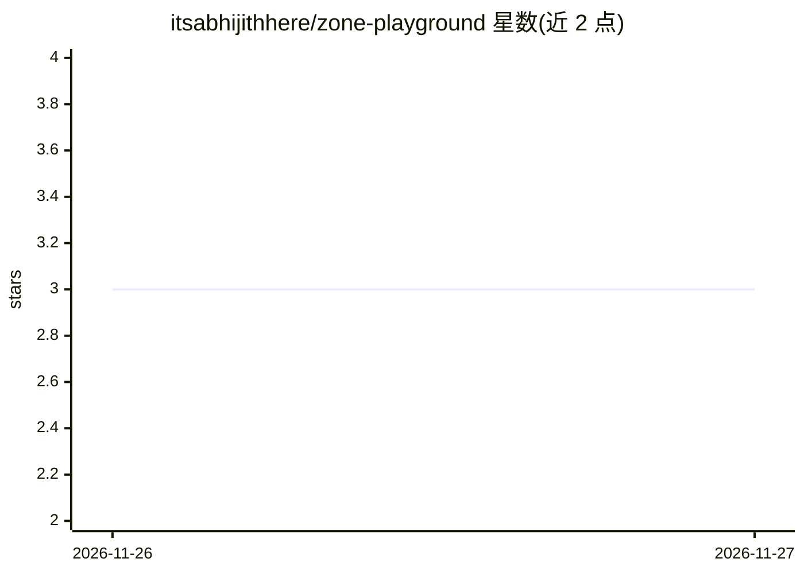

# itsabhijithhere/zone-playground

⭐ 3 · JavaScript · 推送 2026-11-24 · [GitHub](https://github.com/itsabhijithhere/zone-playground) · 个人维护

**面向 zOne 开发流程的 Claude Code 插件集：规划构建、测试、Azure DevOps 与工时**

一组 Claude Code 插件，包含 zDev 与 zTest 两个插件（均 2.0.0）。zDev 基于真实代码做功能规划与构建、生成 TRD 并导出 DOCX、编写 SQL migration 形式的 Custom Report、创建和更新 Azure DevOps 拉取请求；zTest 提供 QA 代码审查、Chrome 内 UI 审计（ui-auditor 只读 agent）与 Playwright E2E 测试并生成 PDF 报告。面向使用 zOne 与 Azure DevOps 的开发团队，需 Claude Code 环境及相应模型（Opus/Sonnet）会话。

## 筛选速览

| 维度 | 判定 | 备注 |
|---|---|---|
| AI 角色 | `ai-ecosystem` | LLM/agent 周边工具 |
| 许可风险 | `none` | — |
| 部署形态 | `library` | 以包/库形式分发 |
| 模型依赖 | locked-api |  |
| 硬件要求 | — | 无带数字的原话,不猜 |
| 安装摩擦 | `low` | 无编译、无系统依赖或容器化 |
| 成熟度 | — | 结构信号不足 |

## 能力要点

- zDev：基于真实代码读写的功能规划-审批-构建流程，计划保存为独立文件供新会话构建
- zTest：ui-auditor 只读 agent 遍历菜单/弹窗/滚动条等并输出带度量的缺陷报告（PDF）
- PR 工作流：自动选目标分支、关联 bug/task、标记依赖 PR，并按用户要求才提交推送
- 安全机制：改应用代码需用户批准；migration 只写文件不执行

## 适用场景

- 在 Claude Code 中对着真实代码库规划和实现新功能
- 用 Playwright E2E 与 UI 审计全面测试已实现的功能
- 在 Azure DevOps 中按根因分组修复活跃 bug 并生成规范 PR
- 起草并导出符合 FedRAMP 意识要求的 TRD 文档

## 场景标签

`编码 Agent` `代码审查` `浏览器自动化` · 领域:效率与自动化

## 证据(README 行号)

> L3: Claude Code plugins for zOne work: plan and build features, plan fixes for your Azure DevOps bugs, add Custom Report
> L116: |**zDev**|`plan`, `new-trd`: nothing extra; Figma links need the Figma connector; HTML walkthroughs and the final 

## 星数曲线

2026-11-26 3 → 2026-11-27 3（+0）

---
*卡片 v1 · prompt 1.4 · 生成 2026-11-26 · 置信度 mid · 依据 README sha `8c37d06fb96d` · [字段定义](../../DATASET.md)*
