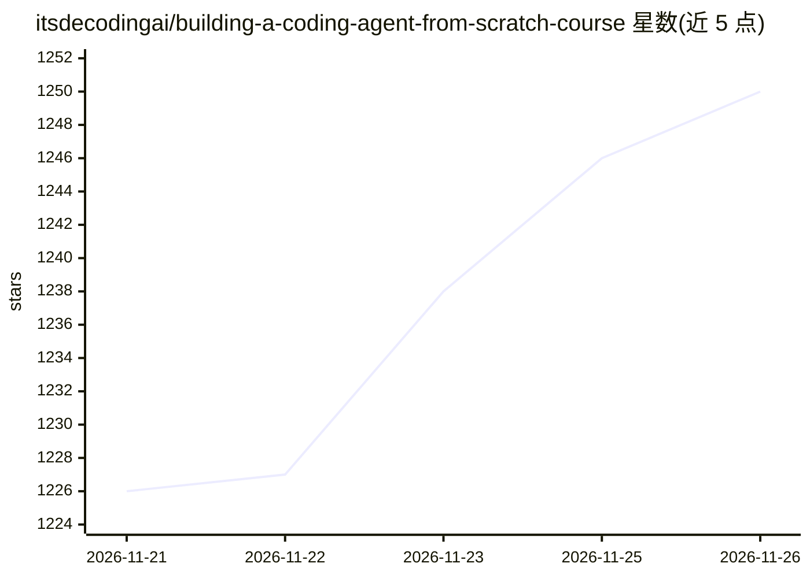

# itsdecodingai/building-a-coding-agent-from-scratch-course

⭐ 1,250 · Python · Apache-2.0 · 推送 2026-10-24 · [GitHub](https://github.com/itsdecodingai/building-a-coding-agent-from-scratch-course) · 组织维护

**从零构建编码代理的免费开源课程（8篇文章+6视频）**

Decoding AI 与 Modal、Opik、Kitaru 合作的开源课程，共 8 篇文章与 6 个视频，配套一个名为 decode 的编码代理代码库，读者从裸代理循环开始逐步实现工具、技能、权限层、沙箱、记忆、压缩、会话录制回放、子代理扇出与评测等 harness 组件。代理框架用 Pydantic AI，LLM 后端可选 Modal 自托管开源权重、OpenRouter 或 Gemini，沙箱支持本地 Docker 与远程 Modal，评测与追踪用 Opik 和 Kitaru。运行需设 LLM API key，无需 GPU。

## 筛选速览

| 维度 | 判定 | 备注 |
|---|---|---|
| AI 角色 | `ai-knowledge` | 知识聚合/清单类 |
| 许可风险 | `permissive` | Apache-2.0 |
| 部署形态 | `None` |  |
| 模型依赖 | — | README 未给出锁定关系 |
| 硬件要求 | `cpu-ok` | |
| 安装摩擦 | `medium` | 含编译或系统依赖之一 |
| 成熟度 | — | 结构信号不足 |

## 能力要点

- 8 篇文章 + 6 个视频 + 1 个配套代码库，Apache-2.0 许可
- 覆盖 9 个工具的代理循环、权限层与 Docker/Modal 沙箱
- 19 任务基准与回归套件的评测设计（Opik 追踪、Kitaru 录制回放）
- 通过 Modal 部署无头代理，可由 CLI/webhook/cron 触发并行子代理

## 适用场景

- 我想系统学习编码代理 harness 的工程模式
- 我想给自己的代理应用补上评测与回归测试流程
- 我想把无头代理部署到云端按 cron/webhook 触发

## 场景标签

`编码 Agent` `模型评测` `教程课程` · 领域:编码与开发

## 证据(README 行号)

> L6:  Open-source course
> L37: ## 📖 About This Course
> L217: **Engineers who learn by building.** You finish with a working coding agent that teaches you harness engineering p

## 星数曲线

2026-11-21 1,226 → 2026-11-26 1,250（+24）

---
*卡片 v1 · prompt 1.4 · 生成 2026-11-21 · 置信度 high · 依据 README sha `f14b00e20c6b` · [字段定义](../../DATASET.md)*
