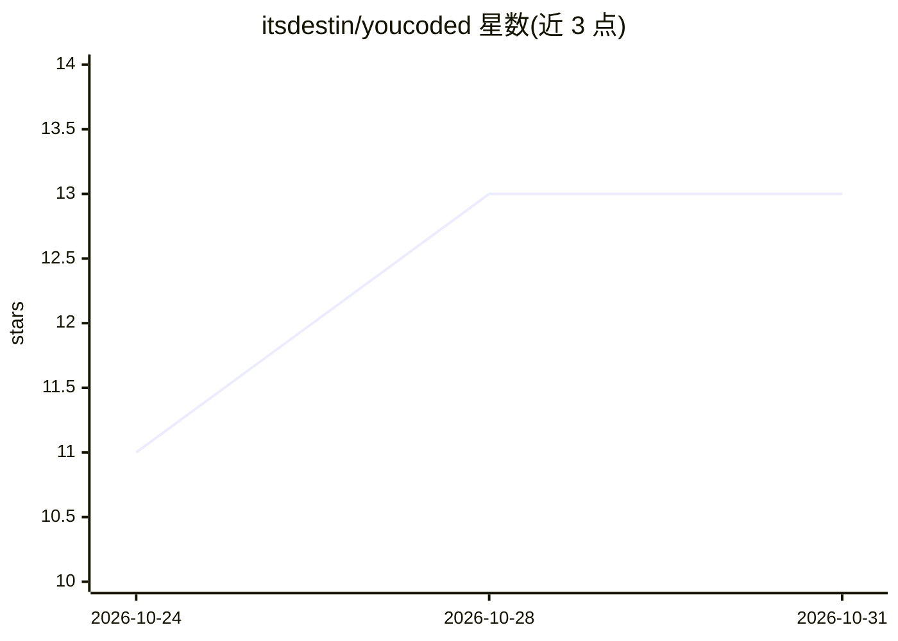

# itsdestin/youcoded

⭐ 13 · TypeScript · MIT · 推送 2026-10-30 · [GitHub](https://github.com/itsdestin/youcoded) · [官网](https://youcoded.ai) · 个人维护

**开源模块化个人 AI 助手与“万物应用”，跨桌面与移动端**

以 AI 助手为核心的桌面（Electron）与 Android 应用：可执行管理文件、搜索网页、读写 Word/Excel/PowerPoint 等 agentic 任务。支持接入 Claude、ChatGPT、OpenRouter 上数百个模型，或本机离线小模型。用户可通过描述创建主题、页面与技能，并在社区市场分享；功能模块可增删重组。行动前会征求许可。桌面端通过 git clone 与 npm 命令从源码构建，Android 端用 gradlew 构建，成品在 youcoded.ai 下载。

## 筛选速览

| 维度 | 判定 | 备注 |
|---|---|---|
| AI 角色 | `ai-native` | 本体是模型或模型工具 |
| 许可风险 | `permissive` | MIT |
| 部署形态 | `None` |  |
| 模型依赖 | — | README 未给出锁定关系 |
| 硬件要求 | — | 无带数字的原话,不猜 |
| 安装摩擦 | `low` | 无编译、无系统依赖或容器化 |
| 成熟度 | — | 结构信号不足 |

## 能力要点

- 接入 Claude、ChatGPT、OpenRouter 数百模型或本地离线小模型
- 通过自然语言描述创建页面/主题/技能，附社区市场
- Word/Excel/PowerPoint 编辑与授权浏览器操作
- 支持 Windows/macOS/Linux/Android，行动前征询用户

## 适用场景

- 让 AI 助手管理文件、搜索网页、编辑文档
- 用对话生成智能家居、财务追踪等自定义应用页面
- 在手机上本地运行助手并通过私有 GitHub 跨设备同步

## 场景标签

`AI 助手` · 领域:对话与助手

## 证据(README 行号)

> L3: **Your personal AI assistant and open source everything app.**
> L13: Well.... kind of everything? Youcoded is an AI assistant at its core, but it's also designed from the ground up to 

## 星数曲线

2026-10-24 11 → 2026-10-31 13（+2）

---
*卡片 v1 · prompt 1.4 · 生成 2026-10-31 · 置信度 high · 依据 README sha `c58d25456d75` · [字段定义](../../DATASET.md)*
