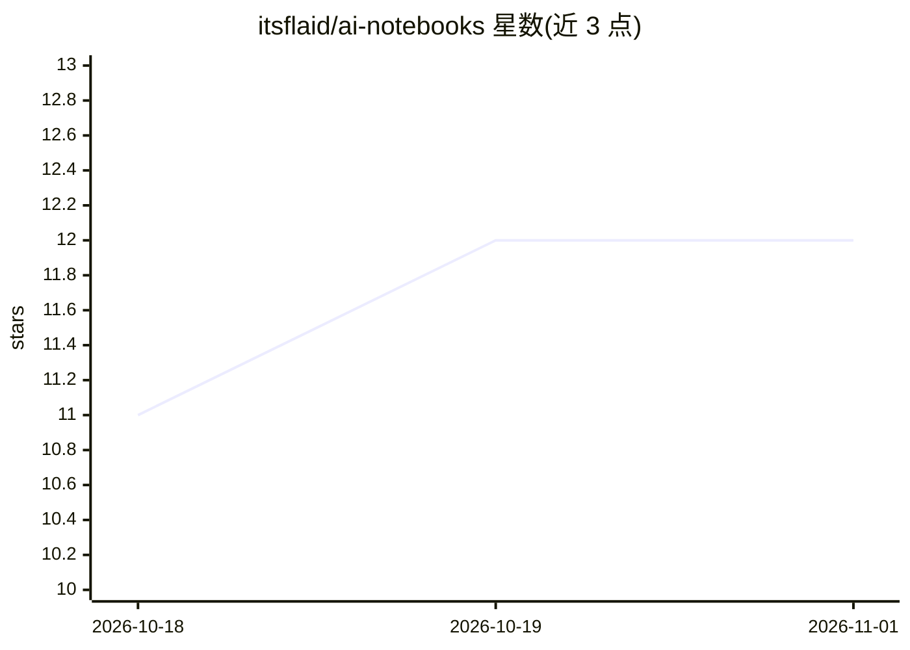

# itsflaid/ai-notebooks

⭐ 12 · Jupyter Notebook · 推送 2026-06-30 · [GitHub](https://github.com/itsflaid/ai-notebooks) · 个人维护

**个人 AI/ML 学习笔记仓库：Jupyter 记录基础概念与小项目**

作者以 Jupyter Notebook 形式记录个人人工智能与机器学习学习过程的仓库，内容为 AI/ML 基础概念和若干小型项目，主题标签含 google-colab 与 jupyter-notebook。仓库未提供安装命令、依赖说明或运行指引，仅为个人学习材料集合，读者可浏览或下载 notebook 查看内容。

## 筛选速览

| 维度 | 判定 | 备注 |
|---|---|---|
| AI 角色 | `ai-knowledge` | 知识聚合/清单类 |
| 许可风险 | `none` | — |
| 部署形态 | `None` |  |
| 模型依赖 | — | README 未给出锁定关系 |
| 硬件要求 | — | 无带数字的原话,不猜 |
| 安装摩擦 | `low` | 无编译、无系统依赖或容器化 |
| 成熟度 | — | 结构信号不足 |

## 能力要点

- 以 Jupyter Notebook 形式组织内容
- 覆盖 AI 与 ML 基础概念及小型项目
- 主题标签提及 google-colab

## 适用场景

- 浏览他人学习 AI/ML 基础概念时的参考笔记
- 查找小型 ML 练习项目的实现思路

## 场景标签

 · 领域:AI/ML 学习资料

## 证据(README 行号)

> L1: this my personal ai learning project using jupyter notebook. this repo have fundamentals of ai and ml concepts and s

## 星数曲线

2026-10-18 11 → 2026-11-01 12（+1）

---
*卡片 v1 · prompt 1.4 · 生成 2026-11-01 · 置信度 mid · 依据 README sha `339b1e15e5bf` · [字段定义](../../DATASET.md)*
