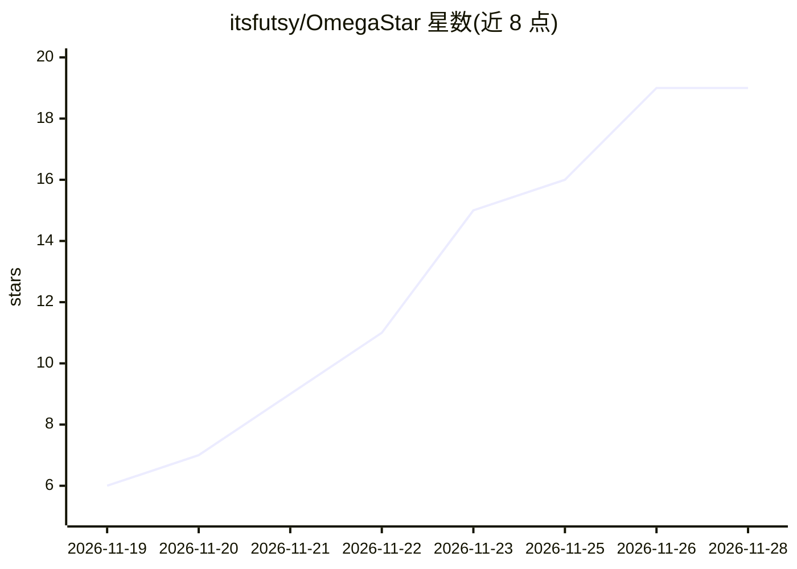

# itsfutsy/OmegaStar

⭐ 19 · Rust · AGPL-3.0 · 推送 2026-11-27 · [GitHub](https://github.com/itsfutsy/OmegaStar) · 个人维护

**把已装好的 Claude Code 组建成 AI 员工团队的桌面应用**

Tauri 桌面应用（macOS/Windows/Linux，AGPL-3.0，alpha 阶段），为已有的 Claude Code 实例添加组织层：每个 AI 员工是用户自己的 Claude Code 以 headless 方式（claude -p）在本机运行，应用本身不含 agent loop 或 API 客户端。功能包括角色与组织图（真人同事一并纳入）、排程、管理者委托、Inbox 审批、通过对话教授并沉淀为可撤销的技能。仅支持 Claude 模型，需本机已安装并登录 Claude Code，无沙箱隔离。

## 筛选速览

| 维度 | 判定 | 备注 |
|---|---|---|
| AI 角色 | `ai-ecosystem` | LLM/agent 周边工具 |
| 许可风险 | `viral` | AGPL-3.0 |
| 部署形态 | `desktop` | 安装包/桌面程序 |
| 模型依赖 | — | README 未给出锁定关系 |
| 硬件要求 | — | 无带数字的原话,不猜 |
| 安装摩擦 | `low` | 无编译、无系统依赖或容器化 |
| 成熟度 | `idea` | |

## 能力要点

- 每个 AI 员工复用用户已配置的 Claude Code，无自建 agent loop
- 角色、组织图（含真人同事）、排程与管理者委托机制
- 对话教学沉淀为可 diff、可撤销的技能，支持自动整理
- Supervised 模式默认限制文件写入范围，工具需逐项批准

## 适用场景

- 为团队或业务中的重复性工作雇佣 AI 员工按排程执行
- 把真人同事与 AI 员工放进同一组织图并通过既有渠道对接
- 通过日常对话持续培训 AI 员工积累技能

## 场景标签

`多智能体` · 领域:Agent 开发

## 证据(README 行号)

> L22: OmegaStar is not another agent. Every AI employee (an autonomous Claude Code agent) is your own Claude Code, runnin
> L68: - **Runs on your Claude Code.** Every run, including the short Haiku calls that check for replies, is a `claude -p`

## 星数曲线

2026-11-19 6 → 2026-11-28 19（+13）

---
*卡片 v1 · prompt 1.4 · 生成 2026-11-20 · 置信度 high · 依据 README sha `6666a4c45629` · [字段定义](../../DATASET.md)*
