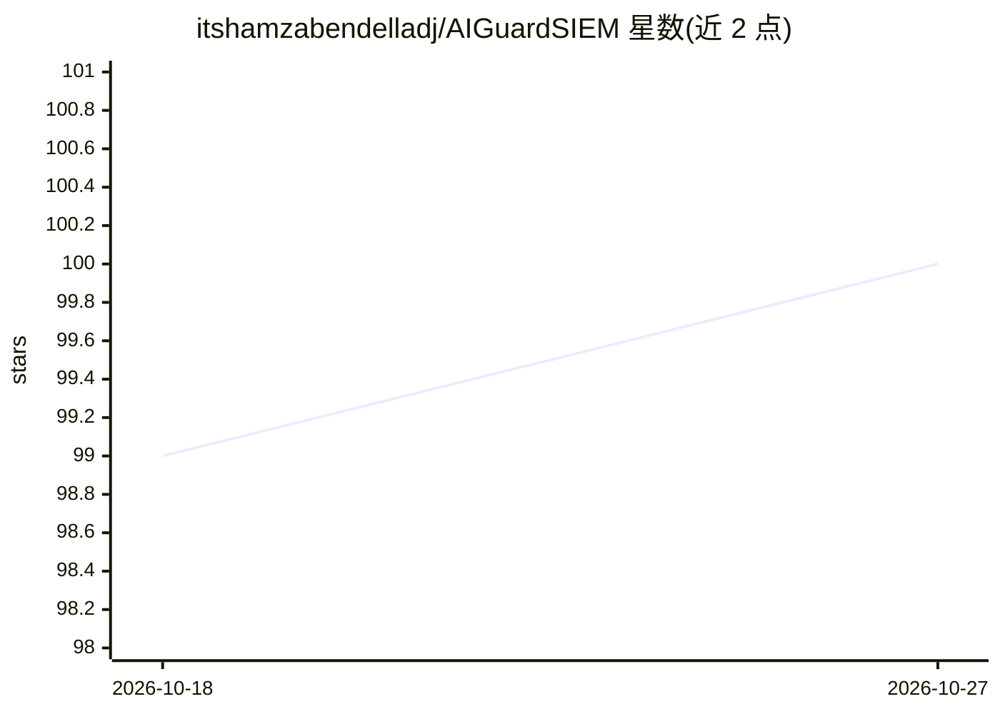

# itshamzabendelladj/AIGuardSIEM

⭐ 100 · C++ · 推送 2026-07-23 · [GitHub](https://github.com/itshamzabendelladj/AIGuardSIEM) · 个人维护

**面向企业 SOC 的高吞吐 SIEM/XDR 平台，含 ML 实时检测**

微服务架构的安全信息与事件管理（SIEM/XDR）平台，采用 C++/Go/Python 混合技术栈：C++ 负责采集器、包捕获与流处理，Go 负责 API 网关与编排，Python 负责 ML 管线（含 ONNX 推理、UEBA 风险评分、强化学习阈值调节）。设计指标为 1M+ EPS 摄入、P99.9 检测延迟 <15ms。采集层支持 syslog、PCAP/DPDK、NetFlow/IPFIX、Windows 事件日志，数据经 ECS 规范化后入 Kafka。README 为技术白皮书形式，可见部分未给出完整安装步骤。

## 筛选速览

| 维度 | 判定 | 备注 |
|---|---|---|
| AI 角色 | `ai-enhanced` | 去掉 AI 部分产品仍成立 |
| 许可风险 | `none` | — |
| 部署形态 | `self-host` | docker 或自建部署 |
| 模型依赖 | — | README 未给出锁定关系 |
| 硬件要求 | — | 无带数字的原话,不猜 |
| 安装摩擦 | `low` | 无编译、无系统依赖或容器化 |
| 成熟度 | — | 结构信号不足 |

## 能力要点

- C++ 采集器结合 DPDK/libpcap/PF_RING 等四种抓包模式
- 实时提取 84 维流特征供 ML 模型（RF/XGBoost/IsolationForest/LSTM）使用
- ONNX Runtime INT8 推理，单事件 <5ms（宣称指标）
- 全部数据统一规范化为 Elastic Common Schema 后入 Kafka

## 适用场景

- 大型 SOC 对百万级 EPS 安全遥测做实时关联与告警
- 对网络流量做基于流特征的异常与恶意软件检测
- 跨 syslog/netflow/Windows 日志/云日志的统一采集与规范化

## 场景标签

`网络安全` · 领域:学习与行业

## 证据(README 行号)

> L9: AIGuardSIEM is a modular, microservices-based Security Information and Event Management (SIEM) platform with Extende
> L15: - **Python (3.11+)** for ML/AI pipelines: supervised and unsupervised learning, deep learning sequence analysis, re
> L58: 4. **Real-time ML inference**: Models are exported to ONNX format and served via ONNX Runtime with INT8 quantizatio

## 星数曲线

2026-10-18 99 → 2026-10-27 100（+1）

---
*卡片 v1 · prompt 1.4 · 生成 2026-10-23 · 置信度 mid · 依据 README sha `84f8aec1af99` · [字段定义](../../DATASET.md)*
