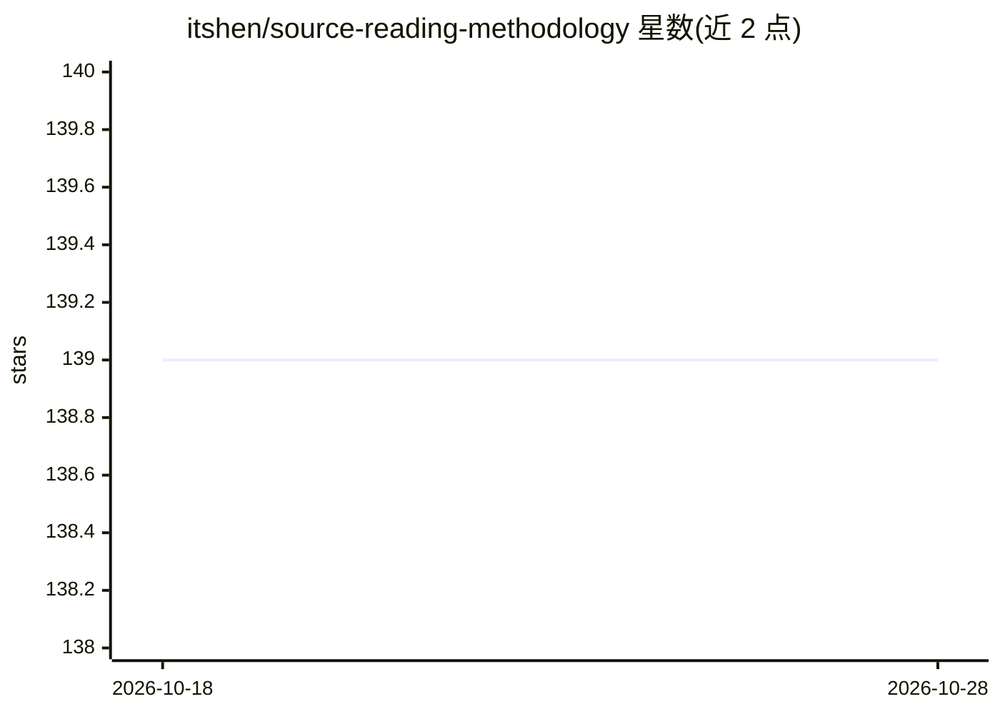

# itshen/source-reading-methodology

⭐ 139 · Python · MIT · 推送 2026-08-24 · [GitHub](https://github.com/itshen/source-reading-methodology) · [官网](https://xueai.app/?from=source-reading-methodology) · 组织维护 · 中文 README

**带 AI 精读大型开源仓库的方法论与模板集**

一套指导 AI Agent 精读陌生大型仓库并产出可验证成果（书/课程）的方法论：通过 SKILL.md 安装为 Agent 技能，按语料准备、大纲、章节书稿、成书四阶段执行，配套写作规范模板、29 条踩坑清单、文风扫描脚本与 HTML 成书脚本。核心规则是每个技术论断必须带「起始行:结束行:文件路径」的可回溯源码引用，并在批量生产前建逐字节校验器。产出形态包括带行号引用的书稿与交互课页。出自小山学堂课程站。

## 筛选速览

| 维度 | 判定 | 备注 |
|---|---|---|
| AI 角色 | `ai-knowledge` | 知识聚合/清单类 |
| 许可风险 | `permissive` | MIT |
| 部署形态 | `None` |  |
| 模型依赖 | — | README 未给出锁定关系 |
| 硬件要求 | — | 无带数字的原话,不猜 |
| 安装摩擦 | `low` | 无编译、无系统依赖或容器化 |
| 成熟度 | — | 结构信号不足 |

## 能力要点

- 四阶段流程：语料准备→大纲→章节书稿→成书，产出物分层不跳级
- 所有源码引用带「起始行:结束行:文件路径」，逐字节校验防幻觉
- SKILL.md 单文件入口，可安装为 Agent 长期技能
- 零依赖文风扫描器与 HTML 成书脚本（book/build_book.py）

## 适用场景

- 带着 AI 把陌生开源仓库读成一门课或一本书
- 让 Agent 产出每句话都可回溯到源码行的精读材料
- 并行派发多个子 Agent 做章节生产并用校验器把关

## 场景标签

`教程课程` `AI 写作` · 领域:内容生成

## 证据(README 行号)

> L3: 一套把陌生的大型仓库读成一门课的方法论。给要做同样事情的人用：选一个开源项目，带着 AI 精读它的源码，最后产出一份别人也能看懂、每句话都能验证的成果。
> L22: 先完整阅读 SKILL.md，把它安装成你可长期使用的 Skill；安装位置和方式由你根据当前运行环境自行判断。
> L44: **让每一个技术论断都可回溯到源码的具体行。**

## 星数曲线

2026-10-18 139 → 2026-10-28 139（+0）

---
*卡片 v1 · prompt 1.4 · 生成 2026-10-22 · 置信度 high · 依据 README sha `941ccdf0b03d` · [字段定义](../../DATASET.md)*
