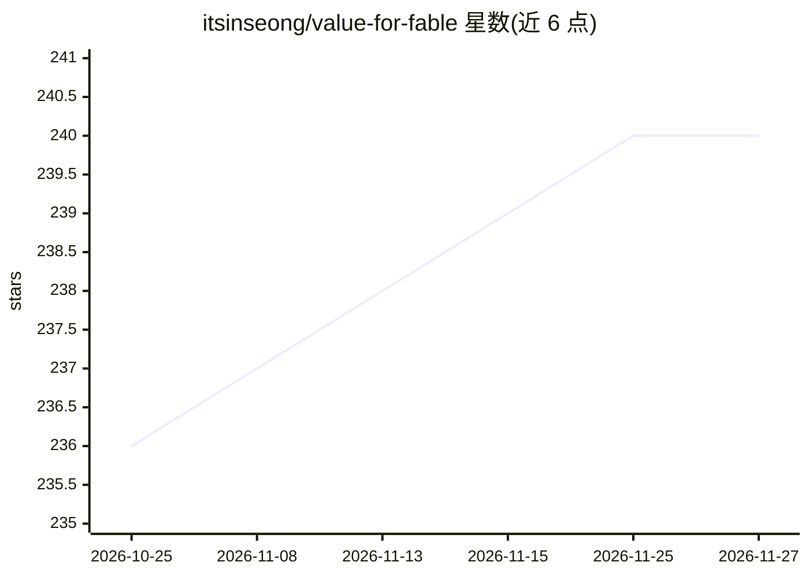

# itsinseong/value-for-fable

⭐ 240 · Python · AGPL-3.0 · 推送 2026-11-21 · [GitHub](https://github.com/itsinseong/value-for-fable) · 个人维护 · 中文 README

**为 Claude Code 注入运营结构、以 Sonnet 单价接近 Opus 品质的插件**

一个 Claude Code 插件，包含会话技能（VFF 触发词）、2-pass 审查子代理、Output Style 常驻模式与防漂移 hook 四类组件。核心机制是把从 Fable 5 观察到的运营模式（结论先行、线索优先、先测量、验证后完成）重构成 8 段 output-style 注入给 Sonnet，作者明确声明这不是蒸馏或复制上层模型，而是引出 Sonnet 自身能力，因此不突破模型推理上限；对纯推理瓶颈任务仍建议路由到 Opus。附带 bench/ 目录的可复现评测框架。

## 筛选速览

| 维度 | 判定 | 备注 |
|---|---|---|
| AI 角色 | `ai-ecosystem` | LLM/agent 周边工具 |
| 许可风险 | `viral` | AGPL-3.0 |
| 部署形态 | `None` |  |
| 模型依赖 | locked-api |  |
| 硬件要求 | — | 无带数字的原话,不猜 |
| 安装摩擦 | `low` | 无编译、无系统依赖或容器化 |
| 成熟度 | — | 结构信号不足 |

## 能力要点

- 8 段运营结构 output-style：结论先行、线索优先假设、先测量、验证后完成
- 会话技能触发/解除（VFF、韩文触发词）与 2-pass 审查子代理（4 项固定审查标准）
- hook 按条件注入提醒（transcript 超 400KB 且 VFF 激活），其余情况注入成本为 0
- bench/ 提供可复现的盲测评测框架与原始数据

## 适用场景

- 在 Claude Code 中以 Sonnet 单价运行诊断/咨询类任务
- 需要结构化技术诊断回答的开发者工作流
- 对 Claude 模型的回答做盲测对比评测

## 场景标签

`提示工程` `模型评测` · 领域:Agent 开发

## 证据(README 行号)

> L3:  Claude Code plugin
> L12:  Claude Code 플러그인, <code>/model sonnet</code>과 함께 사용. 수치는 2026-06 측정(Sonnet 4.6, Opus 4.8 기준)
> L29: VFF가 품질을 끌어올리는 방식은 모델을 바꾸는 게 아니라 **행동 패턴을 바꾸는 것**이다. Fable 5에서 관찰되는 운영 패턴(단서 우선 가설, 측정 먼저, 결론 첫 문장, 검증 후 완료 선언)을 **

## 星数曲线

2026-10-25 236 → 2026-11-27 240（+4）

---
*卡片 v1 · prompt 1.4 · 生成 2026-11-25 · 置信度 high · 依据 README sha `b162e975ebb6` · [字段定义](../../DATASET.md)*
