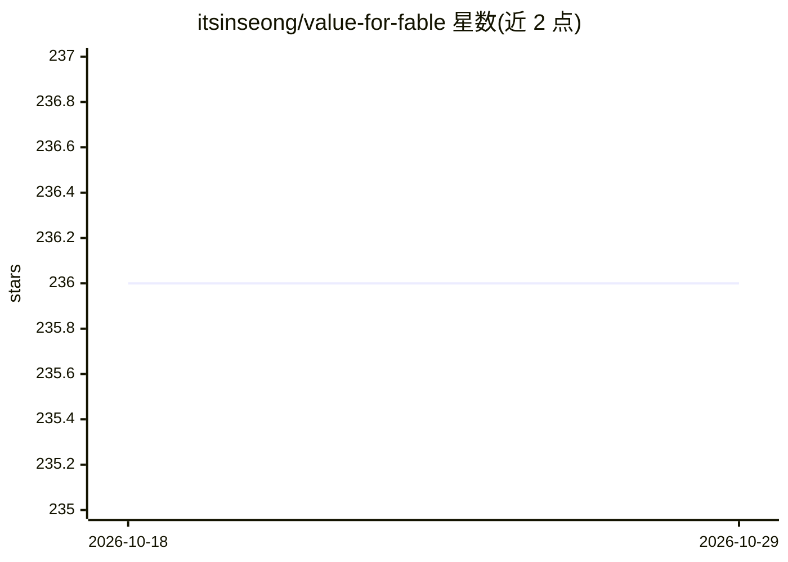

# itsinseong/value-for-fable

⭐ 236 · Python · AGPL-3.0 · 推送 2026-06-21 · [GitHub](https://github.com/itsinseong/value-for-fable) · 个人维护

**Claude Code 插件：给 Sonnet 注入结构化行为规范的 output-style 配置**

面向 Claude Code 用户的插件，包含技能（会话模式，口令触发）、子代理（Sonnet 草稿+可 Opus 覆写的 2-pass 审查，4 项固定审查标准）、output style（全时段被动模式）与 drift 提醒 shell 脚本（在 transcript > 400KB 且激活时注入）。核心是 8 分区行为规则（沟通、推理、工具规范、验证、代码、写作、语气、token 经济），v2 移除 v1 的压缩强制；推荐 v2。通过 Claude Code 插件市场或手动文件拷贝安装；作者声明效果限于诊断/建议风格的回答质量，而非实际编程任务指标，深推理任务推荐 Opus 路由。

## 筛选速览

| 维度 | 判定 | 备注 |
|---|---|---|
| AI 角色 | `ai-ecosystem` | LLM/agent 周边工具 |
| 许可风险 | `viral` | AGPL-3.0 |
| 部署形态 | `None` |  |
| 模型依赖 | locked-api |  |
| 硬件要求 | — | 无带数字的原话,不猜 |
| 安装摩擦 | `low` | 无编译、无系统依赖或容器化 |
| 成熟度 | — | 结构信号不足 |

## 能力要点

- 8 分区行为结构注入 Sonnet（v2 推荐，v1 保留）
- 技能（会话模式）+ 子代理（2-pass 审查）+ output style（持久模式）+ 漂移提醒 hook
- Claude Code 插件市场单命令安装
- bench/ 公开重测数据与 Opus 路由指引

## 适用场景

- 用 Sonnet 价格获得更结构化的诊断/建议类回答
- 长会话中维持注入行为结构不漂移
- 在高难度任务前获得 Opus 路由提示

## 场景标签

`提示工程` · 领域:Agent 开发

## 证据(README 行号)

> L70: VFF가 품질을 끌어올리는 방식은 모델을 바꾸는 게 아니라 **행동 패턴을 바꾸는 것**이다. Fable 5에서 관찰되는 운영 패턴 — 단서 우선 가설, 측정 먼저, 결론 첫 문장, 검증 후 완료 선언 — 
> L79: │   ├── plugin.json             # 플러그인 매니페스트 (name·메타데이터)

## 星数曲线

2026-10-18 236 → 2026-10-29 236（+0）

---
*卡片 v1 · prompt 1.4 · 生成 2026-10-22 · 置信度 high · 依据 README sha `c668d192d728` · [字段定义](../../DATASET.md)*
