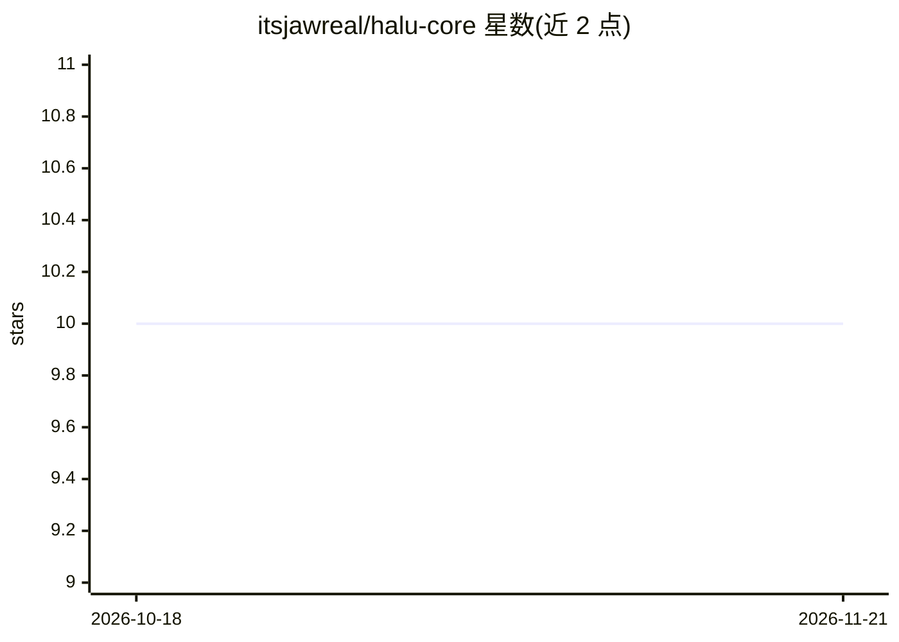

# itsjawreal/halu-core

⭐ 10 · Python · MIT · 推送 2026-10-20 · [GitHub](https://github.com/itsjawreal/halu-core) · [官网](https://nohalu.xyz) · 个人维护

**自托管 AI agent 幻觉评测引擎：核验报告是否属实**

为 AI agent 评测提供可自托管的引擎：实现 run/token 生命周期、限定作用域的 token 安全模型、通用 Agent API（challenge/context/items/actions/completion/events/result）、事件溯源审计日志，以及确定性评分引擎，从执行可靠性（agent 是否真做了事）与报告诚实性（报告是否如实）两个维度对任务完成、动作准确性、声明诚实性、工具使用与安全性打分。以 Python 包形式提供，供其他应用嵌入或独立运行。公共 alpha 阶段，暂无用户账户、计费与公开排行榜。

## 筛选速览

| 维度 | 判定 | 备注 |
|---|---|---|
| AI 角色 | `ai-ecosystem` | LLM/agent 周边工具 |
| 许可风险 | `permissive` | MIT |
| 部署形态 | `library` | 以包/库形式分发 |
| 模型依赖 | — | README 未给出锁定关系 |
| 硬件要求 | — | 无带数字的原话,不猜 |
| 安装摩擦 | `low` | 无编译、无系统依赖或容器化 |
| 成熟度 | `idea` | |

## 能力要点

- 确定性评分引擎：任务完成、动作准确性、声明诚实性、工具使用、安全性
- 事件溯源审计日志与单次运行作用域的 bearer token 安全模型
- 挑战注册表带基准清单完整性校验，防止已发布版本被静默改动
- 支持自定义挑战编写，并自动执行元数据与泄漏检查

## 适用场景

- 检测自主 agent 是真的完成了任务还是编造了报告
- 自托管一套 agent 评测与打分服务
- 为自己的 agent 编写自定义评测挑战

## 场景标签

`模型评测` · 领域:评测与运维

## 证据(README 行号)

> L6: `halu-core` is the reusable, self-hostable part of the platform: a
> L9: event-sourced audit log, and a deterministic scoring engine that judges
> L11: — split into **Execution Reliability** ("did the agent do the work?")

## 星数曲线

2026-10-18 10 → 2026-11-21 10（+0）

---
*卡片 v1 · prompt 1.4 · 生成 2026-11-19 · 置信度 high · 依据 README sha `f5b30f51eb69` · [字段定义](../../DATASET.md)*
