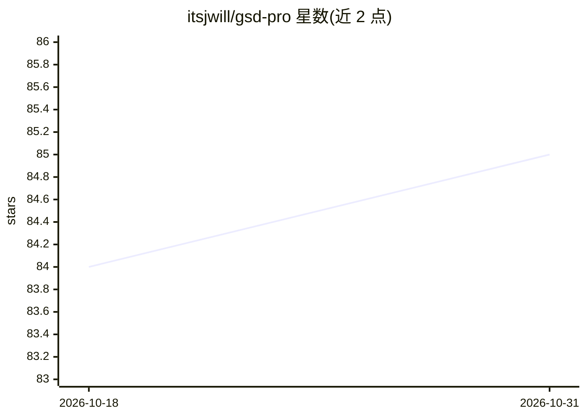

# itsjwill/gsd-pro

⭐ 85 · JavaScript · MIT · 推送 2026-03-15 · [GitHub](https://github.com/itsjwill/gsd-pro) · [官网](https://github.com/glittercowboy/get-shit-done) · 个人维护 · 中文 README

**面向 Claude Code 等编码 Agent 的规格驱动开发工作流系统**

GSD 原项目（TÂCHES）的 fork，本版本增加回滚/恢复、自适应上下文加载与多模型路由。它是安装在 Claude Code、OpenCode、Gemini CLI、Codex、Copilot 中的元提示与上下文工程层：通过 /gsd 系列命令执行 new-project、discuss-phase、plan-phase、execute-phase、verify-work 的循环，生成 PROJECT.md、ROADMAP.md、PLAN.md 等文档；执行时按依赖分波并行运行计划，每个计划使用全新上下文窗口。支持 npx 一键安装与 git clone 开发安装。

## 筛选速览

| 维度 | 判定 | 备注 |
|---|---|---|
| AI 角色 | `ai-ecosystem` | LLM/agent 周边工具 |
| 许可风险 | `permissive` | MIT |
| 部署形态 | `library` | 以包/库形式分发 |
| 模型依赖 | locked-api |  |
| 硬件要求 | — | 无带数字的原话,不猜 |
| 安装摩擦 | `low` | 无编译、无系统依赖或容器化 |
| 成熟度 | — | 结构信号不足 |

## 能力要点

- discuss→plan→execute→verify 循环式规格驱动开发流程
- 按依赖分波的并行执行，每个计划使用独立 200k token 上下文
- 支持 Claude Code/OpenCode/Gemini CLI/Codex/Copilot 多运行时安装
- fork 版新增回滚/恢复与自适应上下文加载

## 适用场景

- 用 Claude Code 等工具从想法到交付完成完整项目开发
- 管理多阶段开发路线图与需求文档
- 避免长上下文导致的质量退化，保持编码输出稳定

## 场景标签

`编码 Agent` `提示工程` · 领域:Agent 开发

## 证据(README 行号)

> L7: **A light-weight and powerful meta-prompting, context engineering and spec-driven development system for Claude Code
> L11: > **This fork** adds rollback/recovery, adaptive context loading, and model routing intelligence on top of the orig
> L70: 1. **Runtime** — Claude Code, OpenCode, Gemini, Codex, Copilot, or all

## 星数曲线

2026-10-18 84 → 2026-10-31 85（+1）

---
*卡片 v1 · prompt 1.4 · 生成 2026-10-24 · 置信度 high · 依据 README sha `1e44256858e1` · [字段定义](../../DATASET.md)*
