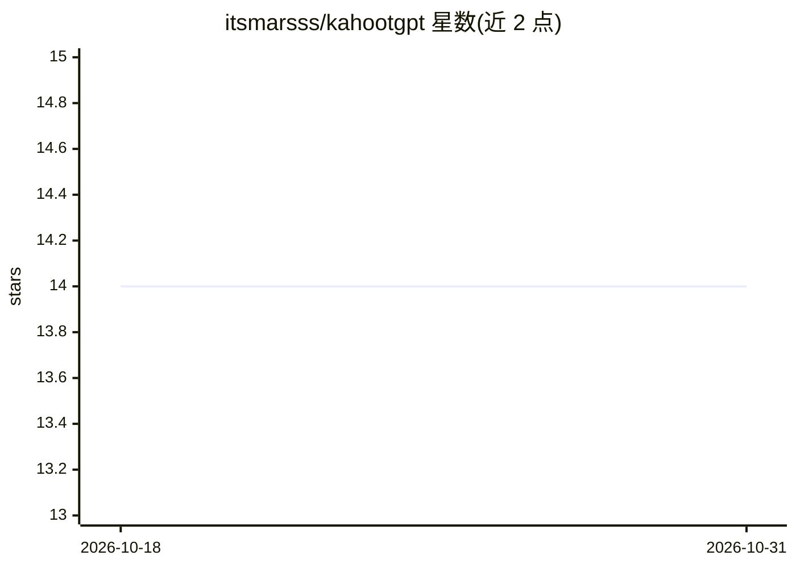

# itsmarsss/kahootgpt

⭐ 14 · JavaScript · GPL-3.0 · 推送 2026-06-03 · [GitHub](https://github.com/itsmarsss/kahootgpt) · [官网](https://itsmarsss.github.io/kahootgpt/) · 个人维护

**用 GPT 自动作答 Kahoot 答题游戏的浏览器扩展**

面向 Kahoot 游戏玩家的 Chrome/Firefox 浏览器扩展：附加到游戏页面后读取题目并调用 OpenAI API 生成答案建议，支持自动高亮最佳答案、自动点选（付费档）、文件上传与多选题。免费档每周 5 次查询（周一重置），无需 API key 即可使用；查询用尽可用自己的 API key 兜底，另有 Light/Monthly/Yearly 订阅。需主持人开启 Show questions & answers 才能工作。技术栈为 React/TypeScript 前端 + AWS Lambda 后端，GPL v3 许可。

## 筛选速览

| 维度 | 判定 | 备注 |
|---|---|---|
| AI 角色 | `ai-native` | 本体是模型或模型工具 |
| 许可风险 | `viral` | GPL-3.0 |
| 部署形态 | `library` | 以包/库形式分发 |
| 模型依赖 | — | README 未给出锁定关系 |
| 硬件要求 | — | 无带数字的原话,不猜 |
| 安装摩擦 | `low` | 无编译、无系统依赖或容器化 |
| 成熟度 | — | 结构信号不足 |

## 能力要点

- 附加到 Kahoot 游戏页面后生成 AI 答案建议
- 自动高亮最佳答案；自动点选为付费档功能
- 免费档每周 5 次查询，后端托管无需 API key，可自带 key 兜底
- 支持文件上传与多选题

## 适用场景

- 玩 Kahoot 时获取 AI 生成的答案提示
- 不想手动点选时使用自动点选模式
- 在公开或私人 Kahoot 游戏中辅助作答

## 场景标签

`浏览器自动化` · 领域:效率与自动化

## 证据(README 行号)

> L3: AI-powered Kahoot assistant. Now with a free tier.
> L21: - AI answer suggestions
> L50: 4. Get AI-generated answers

## 星数曲线

2026-10-18 14 → 2026-10-31 14（+0）

---
*卡片 v1 · prompt 1.4 · 生成 2026-10-31 · 置信度 mid · 依据 README sha `484bb37a620d` · [字段定义](../../DATASET.md)*
