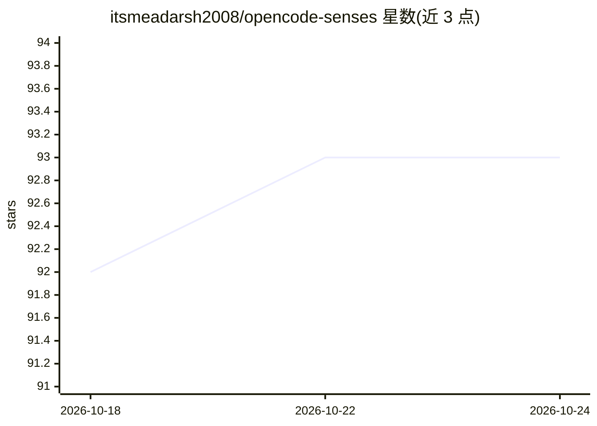

# itsmeadarsh2008/opencode-senses

⭐ 94 · TypeScript · MIT · 推送 2026-10-24 · [GitHub](https://github.com/itsmeadarsh2008/opencode-senses) · [官网](https://www.npmjs.com/package/opencode-senses) · 个人维护

**为 OpenCode 纯文本模型加本地视觉层的插件：OCR/检测/定位**

OpenCode 编辑器的视觉插件（TypeScript）加自动配置的 Python 运行时，为纯文本编码模型提供图像理解：附加图片时自动注入结构化场景读解、caption 与精确 OCR，并提供 13 个 senses_* 工具（inspect、OCR、detect、point、segment、crop、zoom、colors、diff、annotate、metadata、reverse search、status）。默认本地运行 Moondream 2（约 6 GB VRAM），权重首次使用时从 Hugging Face 下载，无需 API key（微调模型除外）。图像内文本被包裹为不可信数据以防提示注入。要求 NVIDIA Ampere+ GPU 或 Apple Silicon。npm 安装，OpenCode 配置中启用即可。

## 筛选速览

| 维度 | 判定 | 备注 |
|---|---|---|
| AI 角色 | `ai-ecosystem` | LLM/agent 周边工具 |
| 许可风险 | `permissive` | MIT |
| 部署形态 | `library` | 以包/库形式分发 |
| 模型依赖 | — | README 未给出锁定关系 |
| 硬件要求 | `gpu-8g` | |
| 安装摩擦 | `medium` | 含编译或系统依赖之一 |
| 成熟度 | — | 结构信号不足 |

## 能力要点

- 附加图片自动注入场景读解、caption 与精确 OCR（无需工具调用）
- 13 个 senses_* 工具，返回归一化、有据可依的结构化证据
- 默认本地运行 moondream2（6 GB VRAM），无 API key
- 图像内文本标记为不可信观察，防提示注入

## 适用场景

- 让纯文本编码模型读懂截图、报错图与 UI 设计稿
- 对截图做精确 OCR、目标定位与局部放大重读
- 基于感知哈希在本地文件中做反向图片搜索

## 场景标签

`多模态` `OCR` `目标检测` · 领域:感知与多模态

## 证据(README 行号)

> L21: Senses adds a vision layer to OpenCode so any image becomes useful to your text-only coding model: screenshots get 
> L47: - The **plugin** (TypeScript, runs inside the OpenCode session) spawns the Python runtime, exposes the `senses_*` t

## 星数曲线

2026-10-18 92 → 2026-10-24 93（+1）

---
*卡片 v1 · prompt 1.4 · 生成 2026-10-18 · 置信度 mid · 依据 README sha `1dca8d00e54d` · [字段定义](../../DATASET.md)*
