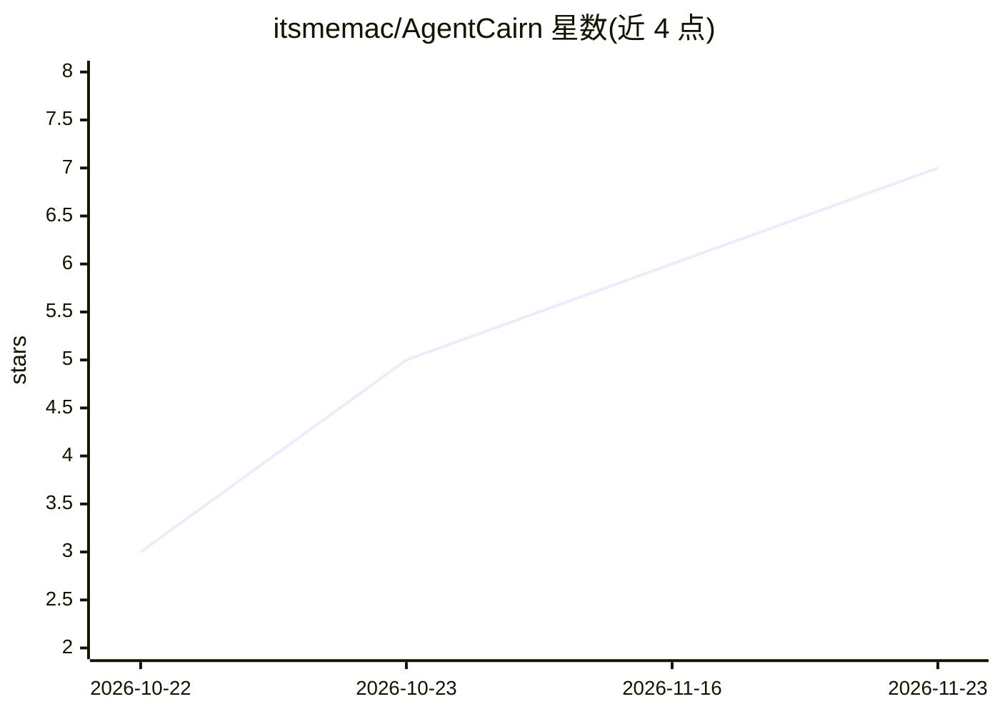

# itsmemac/AgentCairn

⭐ 7 · TypeScript · MIT · 推送 2026-11-21 · [GitHub](https://github.com/itsmemac/AgentCairn) · 个人维护

**AI 编码 agent 的共享持久项目记忆：MCP 服务器+仪表盘**

以 MCP 服务器形式为编码 agent 提供存储在 Neo4j 中的共享项目记忆：agent 通过 cairn_remember/cairn_checkpoint 等工具写入所学内容，新会话通过 token 预算内的 briefing 启动而非重读仓库；会话实时记录并生成 handoff（已完成/进行中/阻塞/已试弃），记忆关联 commit 与文件并标记过期，变更以 supersede 保留历史。服务器自身不调用 LLM，无需 API key。Docker 部署，支持多用户、项目共享、角色与审计，附内置仪表盘。

## 筛选速览

| 维度 | 判定 | 备注 |
|---|---|---|
| AI 角色 | `ai-ecosystem` | LLM/agent 周边工具 |
| 许可风险 | `permissive` | MIT |
| 部署形态 | `self-host` | docker 或自建部署 |
| 模型依赖 | — | README 未给出锁定关系 |
| 硬件要求 | — | 无带数字的原话,不猜 |
| 安装摩擦 | `low` | 无编译、无系统依赖或容器化 |
| 成熟度 | — | 结构信号不足 |

## 能力要点

- 通过 MCP 提供 briefing/handoff/recall/remember 等 10 个工具
- 服务器不调用 LLM：无 API key、无 per-token 成本，兼容任何 MCP-capable agent
- 记忆记录 commit 与文件来源，文件变更时标记过期；变更走 supersede 链保留推理轨迹
- 多用户访问控制（viewer/editor/maintainer）、令牌管理与审计追踪，附实时仪表盘与只读 Cypher 控制台

## 适用场景

- 在多台电脑、多个账号间让 agent 接续同一项目的进度
- 团队成员共享项目约定、决策与踩坑记录供 agent 读取
- 项目交接时新 agent 从 handoff 与 briefing 起步而非重读代码库

## 场景标签

`Agent 记忆` `知识图谱` · 领域:Agent 开发

## 证据(README 行号)

> L3: **Shared, persistent project memory for AI coding agents.**
> L36: - **Agents write the memories.** Through MCP tools (`cairn_remember`, `cairn_checkpoint`) an agent records what it 
> L30:  Claude Code ──MCP over HTTP + token──►  Agent Cairn server  ──bolt──►  Neo4j

## 星数曲线

2026-10-22 3 → 2026-11-23 7（+4）

---
*卡片 v1 · prompt 1.4 · 生成 2026-11-20 · 置信度 high · 依据 README sha `be4d5a73a8e9` · [字段定义](../../DATASET.md)*
