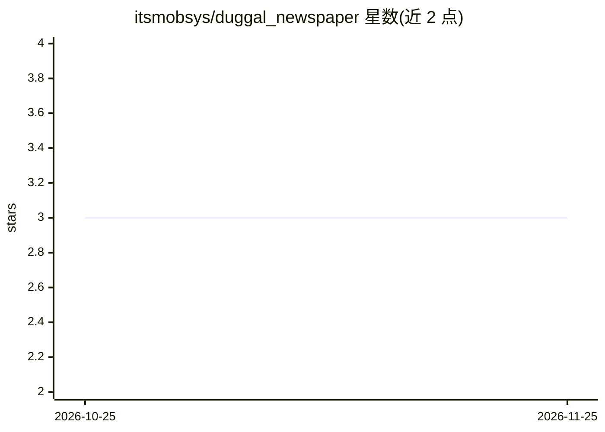

# itsmobsys/duggal_newspaper

⭐ 3 · TypeScript · MIT · 推送 2026-10-23 · [GitHub](https://github.com/itsmobsys/duggal_newspaper) · [官网](https://duggal-newspaper.vercel.app) · 个人维护

**Discord 社区自动报纸：读者投稿、AI 改写后直接发布**

面向 Discord 社区的自治新闻站点：读者用 Discord OAuth 登录后提交标题、正文与最多 4 张照片，AI 改写为统一风格、生成标题/摘要/标签/分类并识别垃圾内容，常规稿件直接上线，仅列举的具体风险类别转人工审核。每日 23:00 IST 由 AI 编排次日版面，AI 不可用时使用确定性回退版式。技术栈为 Next.js + Fastify + TypeScript，队列内嵌于 SQLite，部署在 Vercel、Render、Turso 免费层，MIT 许可。

## 筛选速览

| 维度 | 判定 | 备注 |
|---|---|---|
| AI 角色 | `ai-native` | 本体是模型或模型工具 |
| 许可风险 | `permissive` | MIT |
| 部署形态 | `self-host` | docker 或自建部署 |
| 模型依赖 | — | README 未给出锁定关系 |
| 硬件要求 | — | 无带数字的原话,不猜 |
| 安装摩擦 | `low` | 无编译、无系统依赖或容器化 |
| 成熟度 | — | 结构信号不足 |

## 能力要点

- AI 改写投稿并自动发布，人工只持有紧急停止开关与风险内容审核
- 基于 SQLite 的内置任务队列，无 Redis/Postgres 依赖
- 每日版面为归档快照，通过审核的稿件数秒内上线
- 提供管理后台：审核队列、AI 诊断、审计日志与 kill switch

## 适用场景

- 为 Discord 社区搭建读者投稿式新闻站点
- 零预算（免费云层）运行小型自治内容平台
- 研究 AI 自动编辑流水线与人工兜底机制的结合

## 场景标签

`AI 写作` `工作流自动化` · 领域:效率与自动化

## 证据(README 行号)

> L3: **A community newspaper that writes itself.** Readers file the stories, an AI desk
> L19: |**AI newsroom**|Supplied by MiniMax M3.1 Flash (`minimaxai/minimax-m3.1-flash`). Rewrites copy, writes headlines, 

## 星数曲线

2026-10-25 3 → 2026-11-25 3（+0）

---
*卡片 v1 · prompt 1.4 · 生成 2026-11-21 · 置信度 high · 依据 README sha `faf5ed3253ff` · [字段定义](../../DATASET.md)*
