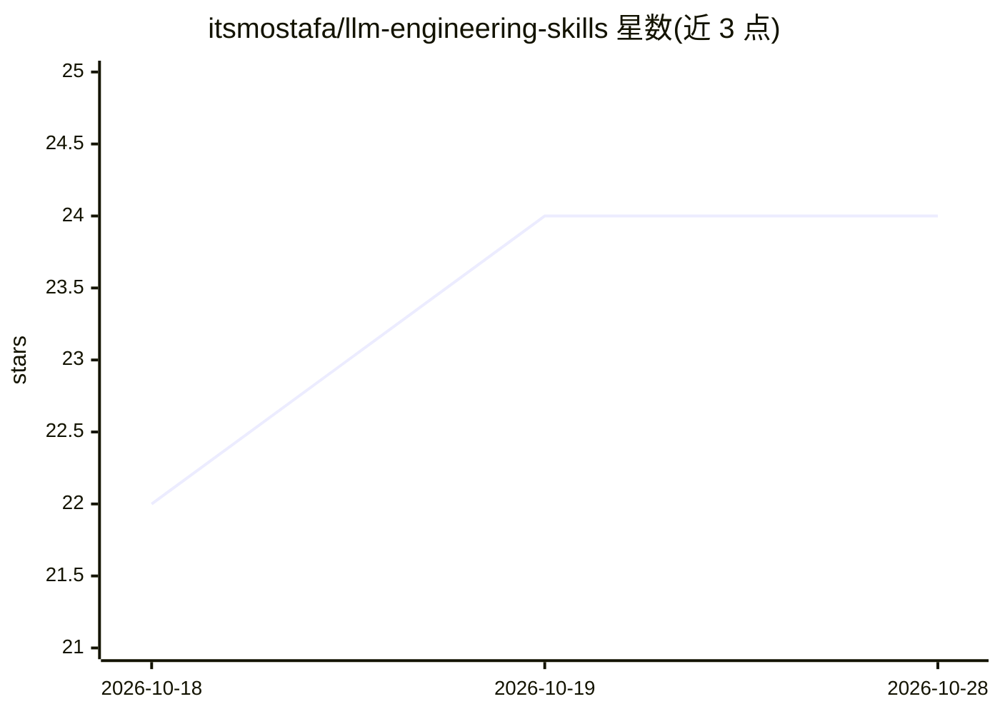

# itsmostafa/llm-engineering-skills

⭐ 24 · MIT · 推送 2026-05-06 · [GitHub](https://github.com/itsmostafa/llm-engineering-skills) · 个人维护

**面向 AI agent 的 LLM 工程技能集合，增强 Claude Code/Codex**

策展的工程技能（SKILL 类知识包）合集，包含 9 个技能：agents、context-engineering、lora、mlx、prompt-engineering、pytorch、qlora、rlhf、transformers，覆盖微调、对齐、本地运行、上下文管理等 LLM 工程任务。技能安装到 Claude Code 或 Codex CLI 后，agent 在相关任务中自动调用这些知识与工作流。安装途径为 Claude Code 插件市场命令、社区 npx CLI 或 Codex skill-installer，要求 Claude Code 1.0.33+ 或 Codex CLI。

## 筛选速览

| 维度 | 判定 | 备注 |
|---|---|---|
| AI 角色 | `ai-knowledge` | 知识聚合/清单类 |
| 许可风险 | `permissive` | MIT |
| 部署形态 | `library` | 以包/库形式分发 |
| 模型依赖 | locked-api |  |
| 硬件要求 | — | 无带数字的原话,不猜 |
| 安装摩擦 | `low` | 无编译、无系统依赖或容器化 |
| 成熟度 | — | 结构信号不足 |

## 能力要点

- 9 个技能覆盖 QLoRA/RLHF/MLX/上下文工程/PyTorch 优化等任务
- 以插件或 skill-installer 方式安装，agent 自动调用
- 同时支持 Claude Code 与 OpenAI Codex CLI

## 适用场景

- 让 Claude Code 帮我在单卡上做 QLoRA 微调
- 给 Codex 装 RLHF 技能以正确实现 DPO 训练
- 在 Apple Silicon 上用 MLX 转换并微调模型

## 场景标签

`精选清单` · 领域:学习与行业

## 证据(README 行号)

> L11: This repository is a curated collection of practical engineering skills designed to make AI agents like Claude Code
> L91: |Skill|Description|

## 星数曲线

2026-10-18 22 → 2026-10-28 24（+2）

---
*卡片 v1 · prompt 1.4 · 生成 2026-10-27 · 置信度 high · 依据 README sha `e01615e38587` · [字段定义](../../DATASET.md)*
