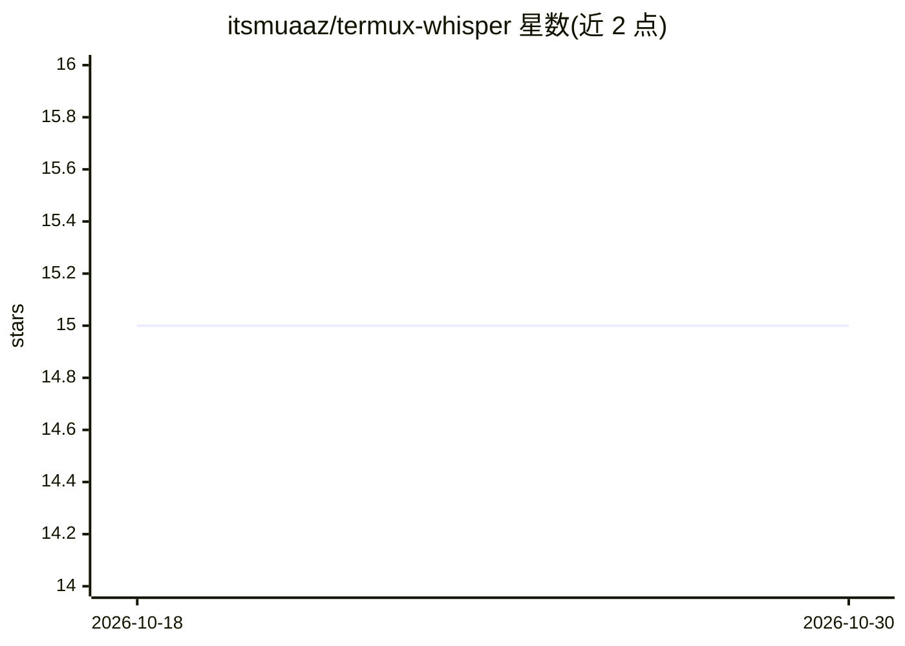

# itsmuaaz/termux-whisper

⭐ 15 · Shell · 推送 2026-02-16 · [GitHub](https://github.com/itsmuaaz/termux-whisper) · 个人维护

**Android 离线语音转文字工具：Termux 上封装 whisper.cpp**

基于 shell 脚本的 whisper.cpp 封装，在 Android 的 Termux 环境中本地转录音频，无需联网。提供一键安装脚本（自动装依赖、拉取引擎并编译）、交互式 TUI 面板与 whisper CLI 命令；支持指定模型、生成 srt/vtt 字幕与 lrc 歌词、批量处理目录、Android 原生文件选择器及系统分享到 Termux 直接转录。兼容 MP3/WAV/OPUS/MKV 等多种音视频格式，转写结果保存到下载目录或文件旁。

## 筛选速览

| 维度 | 判定 | 备注 |
|---|---|---|
| AI 角色 | `ai-native` | 本体是模型或模型工具 |
| 许可风险 | `none` | — |
| 部署形态 | `None` |  |
| 模型依赖 | — | README 未给出锁定关系 |
| 硬件要求 | — | 无带数字的原话,不猜 |
| 安装摩擦 | `low` | 无编译、无系统依赖或容器化 |
| 成熟度 | — | 结构信号不足 |

## 能力要点

- whisper.cpp 在 Termux 上的本地离线转录，数据不出设备
- 生成 .srt/.vtt 字幕与 .lrc 同步歌词
- 批量处理目录与 Android 原生文件选择器、分享到转录
- 一键安装脚本自动装依赖并编译引擎

## 适用场景

- 手机上离线转录录音、会议或语音备忘
- 为视频生成 srt/vtt 字幕文件
- 批量转录整个目录的音频文件

## 场景标签

`语音识别` · 领域:感知与多模态

## 证据(README 行号)

> L4: A lightweight wrapper for whisper.cpp to transcribe audio files locally on Android via Termux. No internet required.
> L37: |**Transcribe File**|`whisper video.mp4`|

## 星数曲线

2026-10-18 15 → 2026-10-30 15（+0）

---
*卡片 v1 · prompt 1.4 · 生成 2026-10-30 · 置信度 high · 依据 README sha `3e91d718e757` · [字段定义](../../DATASET.md)*
