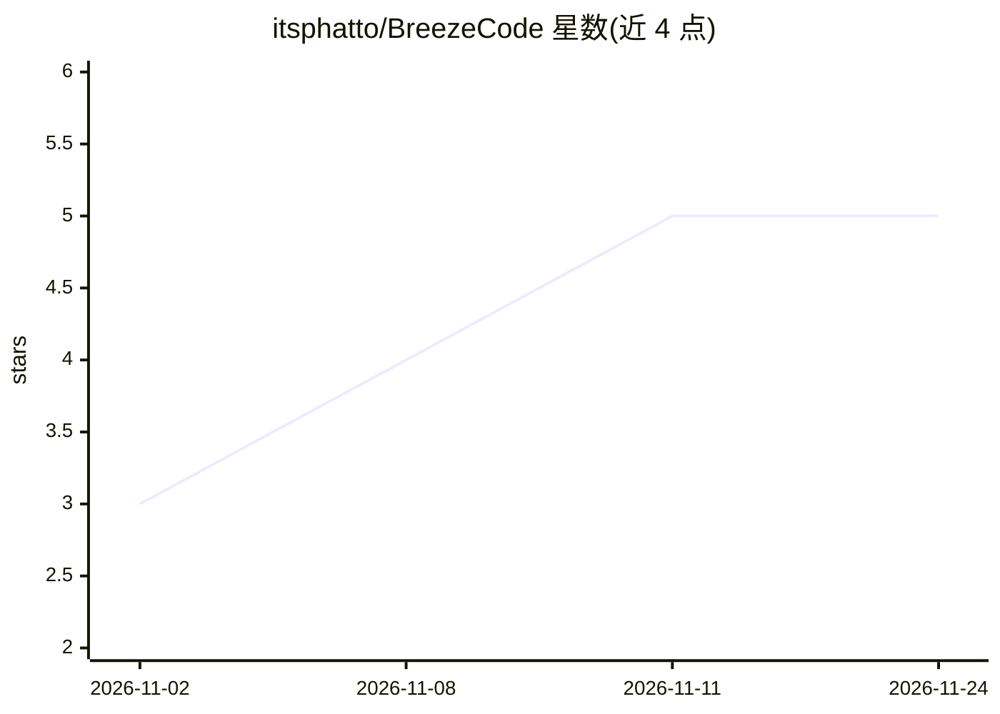

# itsphatto/BreezeCode

⭐ 5 · TypeScript · NOASSERTION · 推送 2026-11-22 · [GitHub](https://github.com/itsphatto/BreezeCode) · [官网](https://www.breezecode.site) · 个人维护

**面向开发者的接入多家 coding agent 的 Rust 引擎代码编辑器**

基于 Electron/TypeScript 并带 Rust 引擎的 Windows 代码编辑器，核心编辑功能（标签分屏、终端、Git、调试器、语言服务器、实时预览）在不连接任何 agent 时即可独立使用（L26）。AI 部分通过读取本机已装的 Claude Code/Codex/Antigravity/OpenCode 的 CLI 或接入本地模型，在面板中展示每次读取、编辑与命令，支持多 agent 并行、文件归属仲裁、Agent Board 并排运行与任务规划模式。仅提供 Windows 安装包下载。

## 筛选速览

| 维度 | 判定 | 备注 |
|---|---|---|
| AI 角色 | `ai-enhanced` | 去掉 AI 部分产品仍成立 |
| 许可风险 | `none` | NOASSERTION |
| 部署形态 | `desktop` | 安装包/桌面程序 |
| 模型依赖 | local-ok | 支持本地模型 |
| 硬件要求 | — | 无带数字的原话,不猜 |
| 安装摩擦 | `medium` | 含编译或系统依赖之一 |
| 成熟度 | — | 结构信号不足 |

## 能力要点

- 发现并接入本机 Claude Code、Codex、Antigravity、OpenCode，复用其自身登录
- 本地模型支持 Ollama、LM Studio 或任意 OpenAI 兼容服务器
- 多 agent 同一提示词分工协作，文件归属冲突由用户裁决
- Rust 引擎支持最大 2GB 文件按屏渲染编辑

## 适用场景

- 在不离开编辑器的情况下让 agent 修改代码并审查每步操作
- 让多个 agent 并行处理同一任务并避免文件编辑冲突
- 用本地模型离线完成代码修改，文件不出本机

## 场景标签

`多智能体` `编码 Agent` · 领域:Agent 开发

## 证据(README 行号)

> L26: - **An editor first.** Tabs, split editors, a terminal, Git, a debugger, live preview and language servers. All of 
> L27: - **Agents you already have.** Breeze finds Claude Code, Codex, Antigravity and OpenCode on your PC and uses their 
> L91: - **Huge files.** Text files open and save through a small Rust engine that runs next to the app. Only the lines on

## 星数曲线

2026-11-02 3 → 2026-11-24 5（+2）

---
*卡片 v1 · prompt 1.4 · 生成 2026-11-21 · 置信度 mid · 依据 README sha `67e97541c03c` · [字段定义](../../DATASET.md)*
