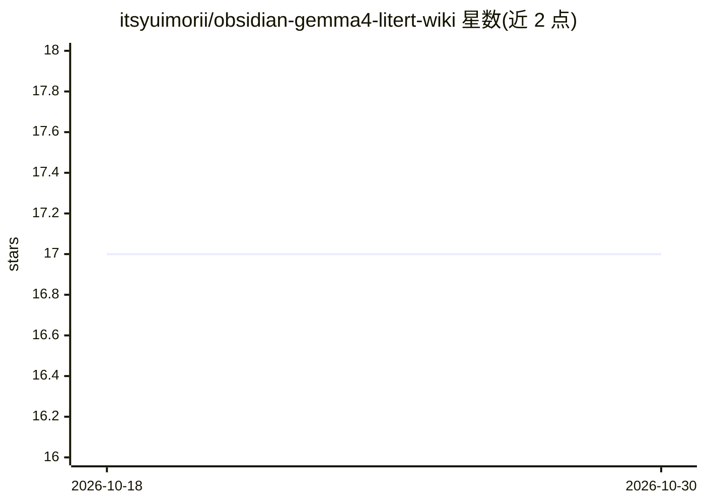

# itsyuimorii/obsidian-gemma4-litert-wiki

⭐ 17 · TypeScript · GPL-3.0 · 推送 2026-10-28 · [GitHub](https://github.com/itsyuimorii/obsidian-gemma4-litert-wiki) · [官网](https://gemma-wiki-demo.vercel.app/tour.html) · 个人维护

**Obsidian 插件：本地运行 Gemma 4 E4B，把笔记构建成 LLM wiki 并对话**

面向 Obsidian 桌面用户的笔记知识库插件：通过 LiteRT-LM 运行时与 WebGPU 在 Obsidian 进程内本地运行 Gemma 4 E4B（约 3GB 模型，一次性下载后离线），无 API key、无服务器。功能包括：为每条笔记生成摘要卡片与索引、统一标签词汇表、概念页、笔记间链接建议、缺口与矛盾检测，以及基于笔记或整个 wiki 的对话、测验与闪卡。实现 Karpathy 的 LLM-wiki 模式：原始笔记不可被模型修改，wiki 作为独立 Markdown 层存在，来源由插件列出而非模型引用。仅支持桌面端与 WebGPU，仅处理 Markdown 笔记。

## 筛选速览

| 维度 | 判定 | 备注 |
|---|---|---|
| AI 角色 | `ai-native` | 本体是模型或模型工具 |
| 许可风险 | `viral` | GPL-3.0 |
| 部署形态 | `None` |  |
| 模型依赖 | — | README 未给出锁定关系 |
| 硬件要求 | — | 无带数字的原话,不猜 |
| 安装摩擦 | `low` | 无编译、无系统依赖或容器化 |
| 成熟度 | — | 结构信号不足 |

## 能力要点

- LiteRT-LM + WebGPU 在 Obsidian 进程内本地推理，一次性下载后离线运行
- 实现 Karpathy LLM-wiki 模式：卡片/索引/概念页/标签词汇，原始笔记不被模型修改
- 三种对话模式（本笔记/Vault/Wiki），来源由插件列出而非模型引用
- 13 个命令：测验、闪卡、缺口查找、溯源抽查、矛盾扫描、自定义技能文件

## 适用场景

- 把已有笔记库变成可对话、可浏览索引的知识 wiki
- 基于自己的笔记生成测验和闪卡用于复习
- 离线、私有地在笔记内问答，不上传任何内容

## 场景标签

`知识库管理` `文档问答` · 领域:知识与检索

## 证据(README 行号)

> L3:  Turn your notes into a living Karpathy LLM wiki. Chat with your vault, connect ideas, find gaps, and generate quizz
> L23: **Gemma 4 E4B builds Andrej Karpathy's LLM wiki out of the notes you already have.**
> L37: **And the model is already inside Obsidian.** Gemma 4 E4B runs in Obsidian's own process through LiteRT-LM and WebG

## 星数曲线

2026-10-18 17 → 2026-10-30 17（+0）

---
*卡片 v1 · prompt 1.4 · 生成 2026-10-29 · 置信度 high · 依据 README sha `c848f9ab8959` · [字段定义](../../DATASET.md)*
