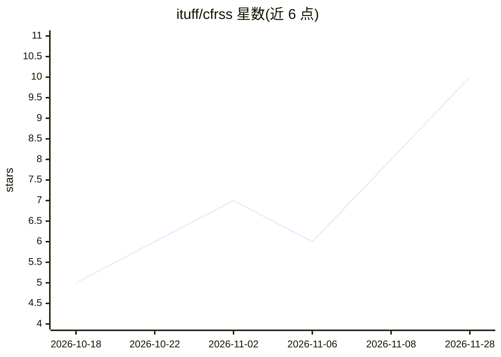

# ituff/cfrss

⭐ 10 · TypeScript · GPL-3.0 · 推送 2026-11-18 · [GitHub](https://github.com/ituff/cfrss) · 个人维护 · 中文 README

**部署在 Cloudflare 免费版的单用户自托管 RSS 阅读器**

运行于 Cloudflare Workers（Hono + D1）的自托管 RSS 阅读器，面向单人使用，无注册与订阅费用。每小时定时拉取订阅源，失败源自动标记跳过；支持分类与 OPML 导入导出、四栏桌面阅读与自适应移动布局、书签跨设备同步。可选接入任意 OpenAI 兼容端点生成文章摘要与 10 种语言全文翻译（保留原排版、结果缓存），并支持朗读播放（0.75×–2× 倍速、19 个语音）。文章全文可归档到用户自己的 GitHub 仓库；未接 GitHub 时仅显示源本身提供的内容。最近 25 篇文章可离线阅读（PWA）。刻意单用户设计。

## 筛选速览

| 维度 | 判定 | 备注 |
|---|---|---|
| AI 角色 | `ai-enhanced` | 去掉 AI 部分产品仍成立 |
| 许可风险 | `viral` | GPL-3.0 |
| 部署形态 | `library` | 以包/库形式分发 |
| 模型依赖 | — | README 未给出锁定关系 |
| 硬件要求 | — | 无带数字的原话,不猜 |
| 安装摩擦 | `low` | 无编译、无系统依赖或容器化 |
| 成熟度 | — | 结构信号不足 |

## 能力要点

- 一键部署或手动部署到 Cloudflare 免费套餐，数据库使用 D1
- 文章摘要与全文翻译（10 种语言）由可选的 OpenAI 兼容端点提供，结果缓存
- 文章全文归档到用户自有 GitHub 仓库，订阅源消失不丢内容
- 离线 PWA、四种主题（含 E-Ink）与中英双语界面

## 适用场景

- 把 RSS 订阅迁到自己 Cloudflare 账号下的私有阅读器
- 对英文文章做全文翻译并对照原文阅读
- 用朗读功能在浏览其他文章时继续收听
- 在手机上离线阅读最近的文章

## 场景标签

`AI 写作` · 领域:内容生成

## 证据(README 行号)

> L5:  **A self-hosted RSS reader that runs entirely on Cloudflare's free tier.**
> L43: - **✦ Article summaries** — one click turns a long article into a short,
> L163: 2. **AI provider** *(optional)* — any OpenAI-compatible endpoint, then assign it

## 星数曲线

2026-10-18 5 → 2026-11-28 10（+5）

---
*卡片 v1 · prompt 1.4 · 生成 2026-11-28 · 置信度 high · 依据 README sha `76c794e0aaa8` · [字段定义](../../DATASET.md)*
