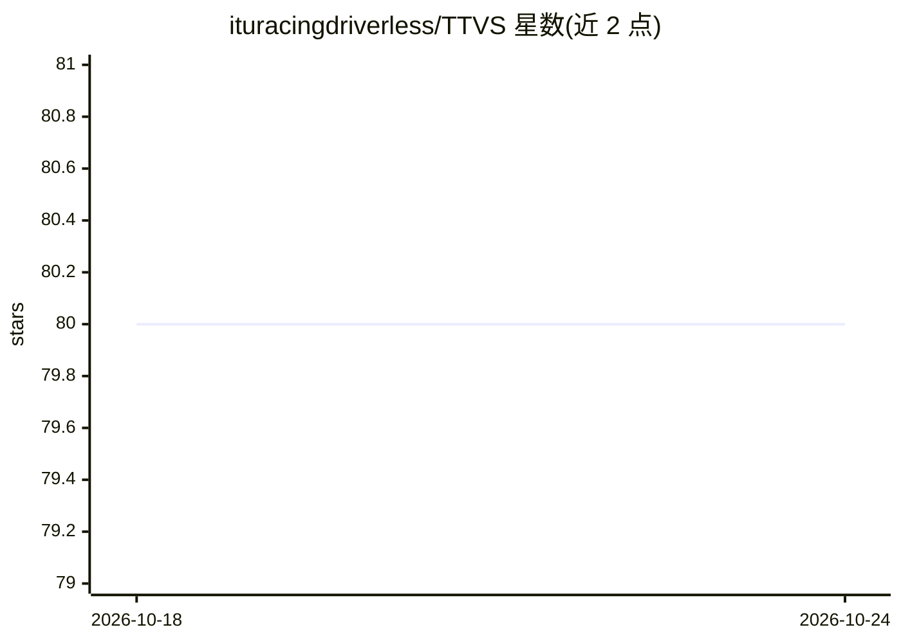

# ituracingdriverless/TTVS

⭐ 80 · Python · 推送 2026-05-06 · [GitHub](https://github.com/ituracingdriverless/TTVS) · 组织维护

**土耳其交通标志数据集：贡献者标注换访问的共享数据集**

ITU Racing Driverless 团队维护的土耳其交通标志图像与标注数据集，当前包含 32 个参与方贡献的 33,764 张已标注图像，标注 3 万余条。采用贡献换取访问机制：需先标注至少 500 张图像并通过 PR 提交，审核后方可获得完整数据集访问权。README 提供邮件联系、fork 仓库上传标注、Pull request 的贡献流程，并列出各团队（GTU、KU AIRS、BOUN BURST 等）的图像与标注数量明细。许可文本以链接形式给出。

## 筛选速览

| 维度 | 判定 | 备注 |
|---|---|---|
| AI 角色 | `ai-knowledge` | 知识聚合/清单类 |
| 许可风险 | `none` | — |
| 部署形态 | `None` |  |
| 模型依赖 | — | README 未给出锁定关系 |
| 硬件要求 | — | 无带数字的原话,不猜 |
| 安装摩擦 | `low` | 无编译、无系统依赖或容器化 |
| 成熟度 | — | 结构信号不足 |

## 能力要点

- 33,764 张已标注图像、32 个参与团队
- 贡献制访问：标注 500 张图像换取完整数据集访问权
- 通过 Google 相册相册与 fork+PR 流程提交贡献
- 按贡献团队列出图像数与标注数明细表

## 适用场景

- 交通标志识别/分类模型的训练数据来源
- 车队或研究团队通过标注贡献换取数据集访问
- 了解土耳其本地交通标志数据规模与来源分布

## 场景标签

`目标检测` · 领域:感知与多模态

## 证据(README 行号)

> L1: # TTVS (Türkiye Trafik Veri Seti)
> L5: Amount of Katılımcı 32
> L6: Amount of labeled Görüntü 33764

## 星数曲线

2026-10-18 80 → 2026-10-24 80（+0）

---
*卡片 v1 · prompt 1.4 · 生成 2026-10-24 · 置信度 high · 依据 README sha `a487488e5dc0` · [字段定义](../../DATASET.md)*
