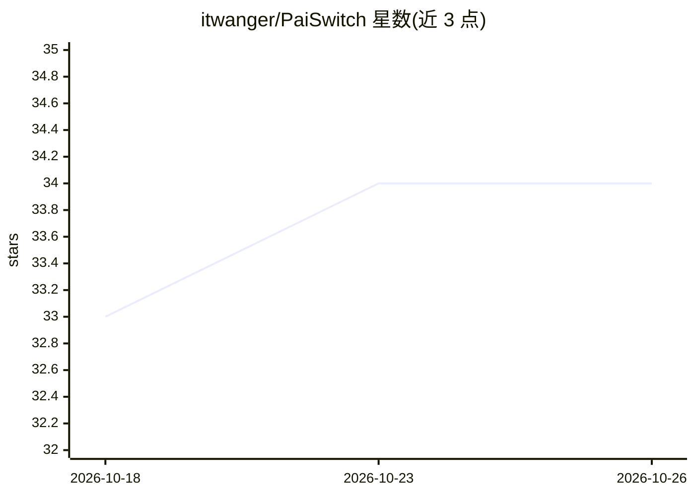

# itwanger/PaiSwitch

⭐ 34 · Java · 推送 2026-06-23 · [GitHub](https://github.com/itwanger/PaiSwitch) · [官网](https://github.com/itwanger/PaiSwitch/releases/latest) · 个人维护 · 中文 README

**给开发者的 AI Coding Agent 模型切换控制台（Claude Code/Codex）**

面向 Claude Code 与 Codex 两类 Coding Agent 的本地模型切换工具：写入 ~/.claude/settings.json 与 ~/.codex/config.toml 等配置，内置官方模型、DeepSeek、智谱、Kimi、Qwen、OpenRouter、SkyClaw、讯飞 MaaS 及自定义 Provider；本地提供 Anthropic Messages / OpenAI Responses 到 Chat Completions 的协议转换代理；含 API Key 加密存储、自然语言切换、配置备份回滚与 Skills 管理。部署形态为 Docker Compose（Spring Boot + Vue 3 + MySQL）与 macOS 菜单栏/Tauri 桌面包。

## 筛选速览

| 维度 | 判定 | 备注 |
|---|---|---|
| AI 角色 | `ai-ecosystem` | LLM/agent 周边工具 |
| 许可风险 | `none` | — |
| 部署形态 | `desktop` | 安装包/桌面程序 |
| 模型依赖 | locked-api |  |
| 硬件要求 | — | 无带数字的原话,不猜 |
| 安装摩擦 | `low` | 无编译、无系统依赖或容器化 |
| 成熟度 | — | 结构信号不足 |

## 能力要点

- 为 Claude Code / Codex 写入模型与 API Key 配置，切换前自动备份
- 本地协议代理：Anthropic Messages / OpenAI Responses 转 OpenAI Chat Completions
- 内置 DeepSeek、智谱 GLM、Kimi、Qwen、OpenRouter、SkyClaw、讯飞 MaaS 及自定义 Provider
- API Key AES 加密存储（Web）/ Keychain 存储（macOS），支持自然语言切换与 Skills 管理

## 适用场景

- 让 Claude Code / Codex 使用 DeepSeek、GLM、Kimi、Qwen 等第三方模型
- 统一管理多个模型供应商的 API Key 与配置，随时回滚
- 把 Codex Responses API 请求转发到 Chat Completions 兼容上游

## 场景标签

`模型网关` · 领域:Agent 开发

## 证据(README 行号)

> L13: |Agent 级切换|面向 Claude Code、Codex 这类 Coding Agent，而不是普通聊天窗口|
> L15: |协议转换代理|将 Codex Responses API、Claude Code Anthropic Messages 请求转换到 OpenAI Chat Completions 兼容上游|
> L16: |多模型供应商|内置官方模型、DeepSeek、智谱、Kimi、Qwen、OpenRouter、SkyClaw、讯飞 MaaS，并支持自定义 Provider|

## 星数曲线

2026-10-18 33 → 2026-10-26 34（+1）

---
*卡片 v1 · prompt 1.4 · 生成 2026-10-25 · 置信度 high · 依据 README sha `0ac2f5722cf7` · [字段定义](../../DATASET.md)*
