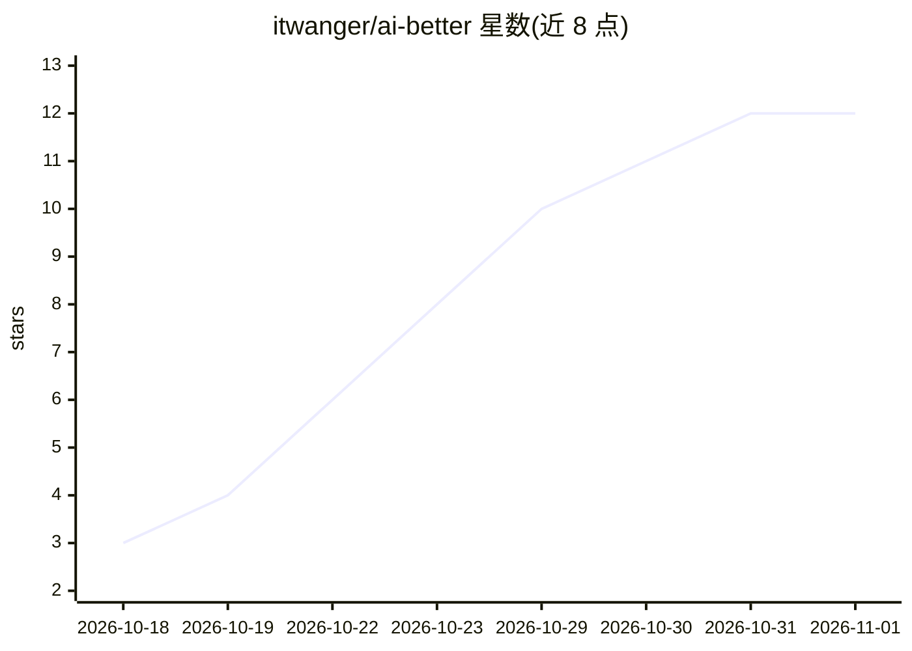

# itwanger/ai-better

⭐ 12 · TypeScript · 推送 2026-10-31 · [GitHub](https://github.com/itwanger/ai-better) · [官网](https://javabetter.cn/ai/video/) · 个人维护 · 中文 README

**面向求职者的 AI Agent 面试题库：369 题图文+视频讲解**

作者将牛客、知识星球和各大厂真实面经中的 Agent 相关高频题整理为一套中文题库，共 369 题，覆盖 Agent 基础、上下文与记忆、Harness 与 Skills、RAG 知识库、LLM 基础、Claude Code 与 Codex、DeepSeek 专题、Prompt 工程等 12 个分类，其中 79 题配图文详解、75 题配口播视频。答案串联作者自己的三个实战项目（PaiCLI 终端 Agent、PaiAgent/PaiFlow 工作流编排平台、派聪明 RAG 知识库）。仓库提供题库 Markdown 原始文件与 Remotion 视频工程，推荐到作者网站在线阅读。

## 筛选速览

| 维度 | 判定 | 备注 |
|---|---|---|
| AI 角色 | `ai-knowledge` | 知识聚合/清单类 |
| 许可风险 | `none` | — |
| 部署形态 | `None` |  |
| 模型依赖 | — | README 未给出锁定关系 |
| 硬件要求 | — | 无带数字的原话,不猜 |
| 安装摩擦 | `low` | 无编译、无系统依赖或容器化 |
| 成熟度 | — | 结构信号不足 |

## 能力要点

- 369 道题按 12 个分类组织，标注三级难度
- 79 篇图文详解 + 75 条口播视频
- 附每条视频的 Remotion 工程与成片原始文件
- 答案关联作者三个实战项目（终端 Agent / 工作流编排 / RAG 知识库）

## 适用场景

- 准备大厂 AI Agent 方向的技术面试
- 系统学习 Agent、RAG、MCP、LLM 基础知识
- 跟随视频讲解对照实战项目理解工程实现

## 场景标签

`教程课程` · 领域:学习与行业

## 证据(README 行号)

> L18: 我把牛客、知识星球和各大厂真实面经里的高频题整理成一套 Agent 八股，按出现频次和难度筛选，随视频更新持续追加。每道题都有简答，高频题配一篇图文详解和一条口播视频。答案不停留在概念上，会串到我自己写的三个实战项目里讲：
> L24: 这个仓库是这套题的全部原始文件，包括题库、每篇图文的 Markdown，以及每条视频的 Remotion 工程和成片。
> L43: |**合计**|**369**|**79**|**75**|

## 星数曲线

2026-10-18 3 → 2026-11-01 12（+9）

---
*卡片 v1 · prompt 1.4 · 生成 2026-11-01 · 置信度 high · 依据 README sha `f3bad69c01ed` · [字段定义](../../DATASET.md)*
